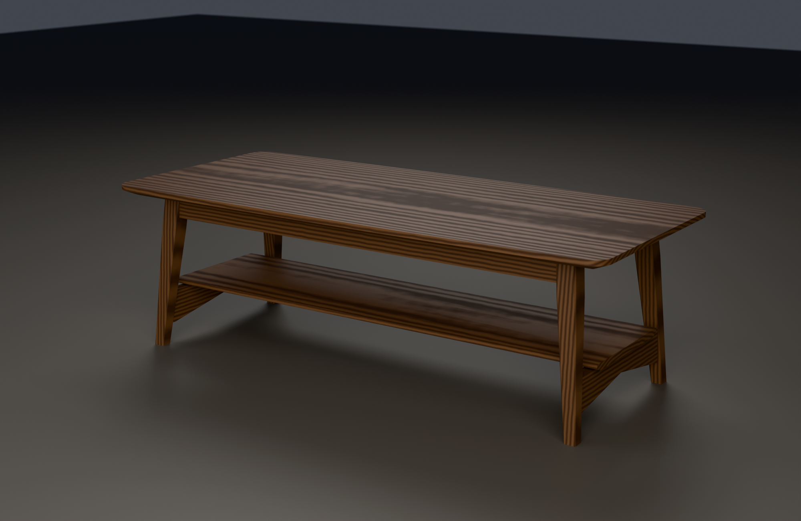

# Coffee table — solid walnut

**48" long × 21" deep × 15" high.** One plane, floating. A soft-edged solid
walnut slab, undercut so hard on its underside that a 1" panel shows a 7/16"
arris, hovering over a base that is pulled 2-5/8 to 3-1/2 inches inside its
outline on every side. Two slim rails, four splayed chamfered posts, a thin
shelf. **No visible joinery anywhere.**



| | |
|---|---|
| `coffee_table.scad` | the model, all dimensions in inches |
| `export_table_parts.scad` | writes one STL per board, for the renderer |
| `render_table.sh` | working drawings + meshes, via OpenSCAD (seconds) |
| `render_table_beauty.sh` | photoreal shots, via Blender/Cycles (minutes) |
| `renders/table_*.png` | three-quarter, elevations, exploded, edge and joint details |
| `exports/coffee_table.stl` `.3mf` | the whole piece, in **millimetres** |

---

## The idea

**The top is the piece. Everything else gets out of its way.**

Three moves, and they are all the same move:

1. **The base is recessed.** Its outermost face is 3-1/2" in from the ends of
   the top and 2-5/8" in from its sides. From any angle you actually stand or
   sit at, you see the top's edge, then a band of shadow, then — well back — a
   slim rail. Nothing supports the top where you can see it.

2. **The edge reads 7/16".** The panel is a full inch thick, because a 48 × 21
   top with no breadboard ends has to be its own beam and its own guarantee
   against cupping. All but 7/16 of that inch is chamfered away underneath at
   22°, running 1-3/8" in from the arris. What is left in the light is a line.

3. **The joinery is invisible.** Every leg joint is a shopmade loose tenon,
   glued, in a routed mortise. There is nothing to see and nothing to admire —
   which is the point. The form is the statement.

Then two quieter ones. The long edges **bow out 3/8"** at mid-length, so the
top is 21" through the middle and 20-1/4" at the ends: almost nothing measured,
and it is what stops a 48" rectangle reading as a rectangle. And the corners
are eased on a **1-1/2" radius**, which is what lets the bow look intentional
instead of like a bad glue-up.

15" high, at the low end of the mid-century range, so the top sits below a seat
cushion and it is the edge you see, not the surface.

### The ends stay open

Nothing crosses the ends of the table at the top. The two long rails and the
four legs are the whole of the upper frame; from either end you look straight
through underneath. **That constraint survived the redesign, but the joint that
justified it did not** — see below.

---

## Joinery

Two joints. Both hidden.

### Long rail → leg

One loose tenon per joint: **5/16 × 1-1/2 × 2-1/4**, 1-1/8" into each member,
in routed mortises with rounded ends. Glued.

### Cross rail → leg

**Twin** loose tenons, 5/16 × 1 × 1-1/2, 3/4" into each member, 1-1/2" apart.
Twin rather than one big one for two reasons, and both matter:

- The leg is only 1-3/16" thick where the lower one lands, so no single mortise
  can be both deep enough and safe. Two shallow ones can.
- These four joints are the *entire* racking resistance across the width of the
  table. A single central tenon resists that with whatever moment arm its own
  width gives it; two tenons 1-1/2" apart resist it with 1-1/2 inches of lever.

The cross rail is also tapered in elevation — 3" deep where it meets the leg,
1-3/4" at mid-span. That is not decoration either: depth at the joint is what
racking resistance is made of, and depth at mid-span is only carrying a shelf.

### Why loose tenons and not integral ones

The legs are splayed **8° total, toward the corner** — a real compound splay,
5.66° on each axis, from the identity cos(a)·cos(a) = cos(tilt) that
`wine_rack.scad` already uses. Nothing on a compound-splayed leg is square to
anything. An integral tenon means holding the leg at a compound angle to cut a
mortise *and* cutting a compound shoulder on the rail, and getting both to
agree.

With a loose tenon, every mortise is routed **square to the face it is in**.
The angle lives in one place only: the end cut on the rail, which is a compound
mitre that can be set once and cut four times. The rail's end and the leg's face
end up parallel, and the tenon is just a stick.

To be explicit about the tradeoff, because the original brief ruled dominoes
out: these are **shopmade** loose tenons, 5/16 × 1-1/2 in quartersawn walnut,
cut on the same router jig as the mortises. A loose tenon is a real mortise and
tenon with the tenon made separately — the glue area and the mechanical section
are what you make them. It is not a biscuit and it is not a dowel.

### What was given up

The first version of this table had **wedged through-tenons standing proud**
where the cross rails met the legs, and made a virtue of it: the joint was the
ornament and the ornament was the structure. It was also the single most
Craftsman thing you can put on a coffee table, and it fought everything else
about the piece. It is gone, along with the breadboard ends, the drawbored pegs
and the deep sprung aprons.

**The honest cost:** a wedged through-tenon in a leg is a mechanically locked
joint that works with no glue at all; twin loose tenons are a glue joint. The
table is now noticeably stiffer along its length than across it, and if you sit
on one end and shove sideways you will feel it move in a way the first version
would not have. The cure, if that ever matters, is a pair of end rails at the
top — and it would cost the open end, which is the reason not to.

---

## Wood movement

The part that decides whether this survives ten Quebec winters. It got *harder*
in this version, not easier, because the breadboard ends are gone.

**The numbers.** Walnut's tangential coefficient is about 0.00274 per 1% MC per
inch of width. A house here runs about 6% EMC in February and 10% in August:

| part | width | flatsawn | quartersawn |
|---|---|---|---|
| top, across the width | 21" | **0.230"** (≈ 15/64) | 0.160" (≈ 5/32) |
| shelf, across the width | 11" | 0.121" (≈ 1/8) | 0.084" |

Nothing else on the piece moves enough to matter. Every other part's critical
dimension runs along its grain; the legs are 1-5/8" across the mortises and
move about 0.018", which is inside the glue line.

### How each conflict is handled

1. **Top to base — buttons, and only buttons.** Eight of them, four per rail,
   in a 3/8" × 9/32" groove ploughed along the rail's inner face. The groove
   runs along the *length*, so a button cannot slide along it in the direction
   the top actually moves; instead it rides **out of** the groove as the top
   shrinks. The 1/8" gap between the button's shoulder and the rail is that
   travel. Set it and do not close it up. The middle pair on each rail are
   screwed through round holes and locate the top along its length, where it
   does not move; the rest are in slots.

   `renders/table_edge.png` is a section through exactly that. The white slot in
   the drawing is the gap, drawn at size.

2. **The top's ends and its whole width are unconstrained.** With no end rails
   and no breadboards, nothing at all is fastened across the top's width. This
   is a real structural advantage of the open-ended form and not just a look.

3. **Shelf.** Grain along the table, so it moves across the cross rails'
   length. One screw at the centre of each rail through a round hole, one
   outboard through a 1/4" slot. Nothing else touches it: 1-1/2" of daylight to
   every leg, so it can grow its 1/8" with room to spare.

4. **Everything else is glued**, because nothing else crosses grain.

### Cupping — what replaces the breadboard ends

Dropping the breadboards removes the only thing that was mechanically holding
the top flat. Nothing in this design does that job, so flatness has to come out
of the stock and the finish instead. That is not hand-waving; it is five
specific decisions:

- **Rift or quartersawn stock for the whole top.** Not a preference — the
  requirement. Quartersawn walnut cups a fraction of what flatsawn does, and it
  also cuts the seasonal width change by a third (see the table above). Expect
  to pay for it and expect to wait for it.
- **Four boards of about 5-1/4", not two of 10-1/2".** Narrow boards cup less,
  and four glue lines distribute what movement there is.
- **Do not alternate the growth rings.** That advice is for flatsawn tops, and
  all it does is turn one cup into three. With quartersawn stock the rings are
  vertical in every board and there is nothing to alternate.
- **One full inch thick.** Cupping resistance goes with the cube of thickness;
  1" is 1.5× as stiff as 7/8". This is why the top is not thinner, and the
  undercut is why you cannot tell.
- **Finish both faces identically, on the same day, with the same number of
  coats.** A top oiled on the show face and left bare underneath will cup, and
  it will cup toward the bare side. Most common cause, easiest to avoid.

**Be honest about the residual risk:** the undercut removes material from the
outer 1-3/8" of the underside, so the extreme edge of the top is thinner than
the panel and will move a little more than the middle. That is the price of the
7/16" arris, it is small, and quartersawn stock is what pays it.

---

## Cut list

Walnut, from 5/4 and 4/4 rough. Lengths are finished; add the usual for
trimming. One table.

### Boards

| # | part | finished T × W × L | notes |
|---|---|---|---|
| 1 | top | 1 × 21 × 48 | 20-1/4 at the ends (3/8 bow per side), 1-1/2 radius corners, 22° undercut leaving a 7/16 arris. **Rift or quartersawn**, four boards ≈ 5-1/4 |
| 2 | long rail | 1-1/8 × 2 × 37-3/4 | between the legs; ends cut at the compound splay angle |
| 4 | leg | 1-5/8 × 1-5/8 × 14-3/16 | 14.138 on its own axis; 1-5/8 sq for the top 3", then tapered on all four faces to 1" at the foot; 1/8 chamfer on all four arrises, narrowing with the taper. Two handed pairs. |
| 2 | cross rail | 7/8 × 3 × 14-1/4 | between the legs; 3 deep at the legs tapering to 1-3/4 at mid-span; ends compound |
| 1 | shelf | 5/8 × 11 × 43-5/16 | 1/4 undercut on the underside of both long edges |
| 8 | button | 1/2 × 7/8 × 1-1/8 | 1/4 × 3/8 tongue |
| 4 | loose tenon, long rail | 5/16 × 1-1/2 × 2-1/4 | quartersawn, grain along the length, ends rounded |
| 8 | loose tenon, cross rail | 5/16 × 1 × 1-1/2 | same |

### Angles and joint sizes

| | |
|---|---|
| leg splay | **8° total** toward the corner = **5.661° on each axis** |
| leg taper | 1.607° per face, below the top 3" |
| long rail end cut | compound, to meet a face splayed 5.661° each way |
| cross rail end cut | the same, **plus** the leg's 1.607° taper |
| long rail mortises | 5/16 × 1-1/2, 1-1/8 deep, in the leg's inner face and in the rail's end |
| cross rail mortises | 5/16 × 1, 3/4 deep, twin, centred 1-1/2 apart |
| leg thickness at those two | 1.156 and 1.241 — a 3/4 mortise leaves 0.40 and 0.49 behind it |
| button groove | 3/8 deep × 9/32, 1/2 down from the rail's top edge |
| base recess | 3-1/2 from the ends of the top, 2-5/8 from its sides at the legs |
| foot centres | 2.92 from the end, 2.42 from the side — the feet stay under the top |

Every number comes out of the model:

```sh
openscad -o /dev/null -D 'mode="none"' coffee_table.scad   # prints them all
```

---

## What this build demands

Honestly: **this is harder than the first version was**, not easier. Hiding the
joinery did not simplify anything; it moved the difficulty from "cut a joint
that shows" to "cut eight joints at a compound angle that have to close
perfectly because there is nothing to hide behind."

### Machines

| | why |
|---|---|
| **Router** with a shopmade mortising jig, or a slot mortiser | twenty-four mortises, eight of them in a leg that has to be held at a compound angle |
| **Compound mitre saw**, or a table saw with a tilting blade and a mitre gauge you trust | four long rail ends and four cross rail ends, all compound |
| **Table saw** with a good blade | leg tapers, the chamfers, the shelf |
| **Bandsaw** | the top's bow and corners, the cross rail's taper, roughing the leg tapers |
| **Planer and jointer** | 5/4 and 4/4 rough to four thicknesses, and 21" of glued-up top flat |
| **A router sled or a wide drum sander** | flattening the top |
| **A big chamfer bit, or a hand plane and patience** | 1-3/8" of undercut around a bowed, radiused perimeter |
| **Clamps** | a four-board top, and a base that has to go together in one glue-up |

### Skills

1. **Compound-angle layout.** Every one of the eight leg joints is at 5.661° on
   two axes. Cut them all from one setup, mark every leg for hand and face
   before you touch a cutter, and dry-fit the whole base before any glue.
2. **Routing accurate mortises in small stock.** The cross rail mortises leave
   0.40" of wood behind them. Blow one out and the leg is firewood.
3. **Undercutting a curved edge.** The bow and the eased corners mean the
   chamfer is not a straight run. A bearing-guided bit following the top's own
   edge is the only sane way, and the last of it is a spokeshave and a scraper.
4. **Flattening a 21"-wide quartersawn panel** without a wide sander — a router
   sled, or a No. 7 and winding sticks, and the discipline to check it again a
   week later.
5. **Fairing a 3/8" bow over 48".** It has to be a fair curve or it looks like a
   mistake. Spring a batten, mark, bandsaw wide, true it with a plane.
6. **A single-shot base glue-up.** Eight loose-tenon joints, all compound, all
   closing at once. Rehearse it dry with the clamps in place.

### Where it will go wrong

- **Finishing the top on one side only.** With no breadboards this is now *the*
  failure mode, not merely a mistake. It will cup.
- **Buying flatsawn stock for the top** because the quartersawn is three weeks
  out. The whole cupping strategy rests on this one decision.
- **Closing up the button gap** by driving the screws home hard. That gap is
  the movement.
- **Cutting all four legs to the same hand.** They are two handed pairs, and
  with a compound splay a wrong-handed leg is not fixable.
- **Trusting one compound-angle setup without a test cut** in scrap of the same
  thickness.
- **Assembling the base out of sequence.** Cross rails into the legs first, then
  the two long rails between the end assemblies.

### Order of work

1. Mill everything oversize; sticker it a week; mill again to final size.
2. Legs: mortises first, on square blanks, then the taper, then the chamfers.
3. Rails: compound end cuts, then mortises in the ends, then the cross rail
   taper.
4. Dry-assemble the entire base. Twice.
5. Glue the two end assemblies (2 legs + 1 cross rail), then the long rails.
6. Top: glue up, flatten, shape the bow and the corners, then the undercut last.
7. Shelf, buttons, finish — both faces, same day.

---

## Reproducing the drawings

```sh
./render_table.sh          # every OpenSCAD view + coffee_table.stl / .3mf
./render_table_beauty.sh   # per-part STLs + three Cycles renders in walnut
SAMPLES=800 RES=2600x1700 ./render_table_beauty.sh
```

```sh
openscad coffee_table.scad
openscad -D 'mode="exploded"' coffee_table.scad
openscad -D 'mode="joint"'    coffee_table.scad   # leg, rails and loose tenons
openscad -D 'mode="edge"'     coffee_table.scad   # section through the float
openscad -D 'mode="base"'     coffee_table.scad
openscad -D 'mode="parts"'    coffee_table.scad
openscad -D LEG_TILT=12 -D LEN=54 coffee_table.scad   # everything follows
```

### Views

| | |
|---|---|
| `table_hero.png` | three-quarter |
| `table_persp_end.png` | three-quarter from the open end |
| `table_front.png` / `table_side.png` | orthographic elevations |
| `table_top.png` | the plan — the bow and the eased corners |
| `table_edge.png` | **section through the top's edge**: the arris, the undercut, the recess, and a button with its travel gap |
| `table_joint.png` | leg, both rails and all three loose tenons drawn apart |
| `table_exploded.png` | every part along the axis it assembles on |
| `table_base.png` | the base without the top |
| `table_parts.png` | every unique part |
| `table_beauty_*.png` | Cycles, walnut |

### Two traps worth writing down

- **OpenSCAD's OpenCSG preview silently drops whole subtractions from
  non-convex solids.** Every rail here is a blank with half spaces and mortises
  taken out of it, and the preview cheerfully drew the rails running straight
  through the legs while the CGAL mesh was correct all along. Every part that is
  a difference is wrapped in `render()`, with `color()` **outside** it.
- **Sibling `color(difference(...))` nodes get merged** into one CSG product by
  the preview and come out in the last colour declared. `render()` fixes that
  too, which is why the section drawing has three colours in it.

### The wood shader

`blender/scene.py` renders both pieces in this repo. The pith-based ring scale
was tuned for the wine rack's 9"-wide boards; on a 21" top at that pitch it
reads as corduroy, and on a 1-5/8" leg it aliases into a herringbone. There is
now a `--rings` multiplier (default **1.0**, so the wine rack is untouched) and
the table renders pass `--rings 0.12`. The legs also get their own material with
the pith eight times further out — a leg is riftsawn stock and should show
straight grain, not the cathedral figure of a wide board squeezed into 1-5/8".

Verified after the change: re-rendering the wine rack in walnut gives an image
with a mean absolute difference of 0.001/255 from the committed
`renders/beauty_walnut.png`.

### Units

Design math is in inches, scaled by `UNIT = 25.4` on output, so the emitted
scene is millimetres — same reasoning as `wine_rack.scad`. The mesh is manifold
(`Simple: yes`, no 2-manifold warning); the volume count is the assembly plus
the twelve loose tenons, which float with clearance inside their mortises.
