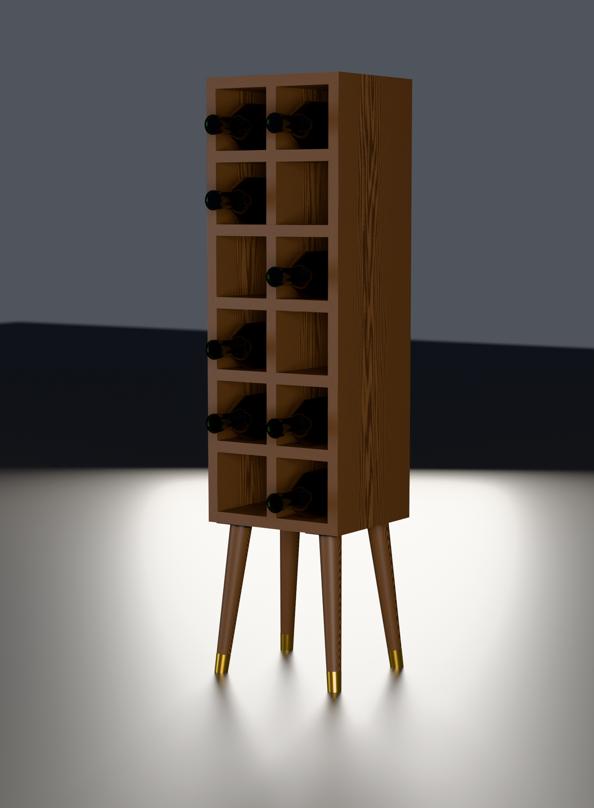

# Mid-century wine rack

Parametric OpenSCAD model of a 12-bottle walnut wine rack — 2 columns × 6 rows
of 4" square openings, 10-1/4" W × 9" D × 39-1/2" H on 10" legs. Shelves housed into the
stiles, interior grid a half-lapped egg crate, four splayed tapered legs on
angled plates with brass ferrules.



**[Read the illustrated build guide](https://claude.ai/code/artifact/a3f2afa2-34b5-4bcf-a35a-0f884b502578)** — every step with the jig
drawings, dimensioned part layouts and renders inline. Works on a phone in the
shop and prints cleanly. Also in this repo as `guide.html`, and generated by
`make_guide.py` so its numbers can't drift from the model.

**[BUILD.md](BUILD.md) is the same guide in plain text** — order of work and
technique, written for a table saw, router, mitre saw and hand tools.

**[CUTLIST.md](CUTLIST.md) is the reference** — every part, size and housing
position.

| | |
|---|---|
| `wine_rack.scad` | the model, all dimensions in inches |
| `jigs.scad` | the shop jigs, drawn so they can be seen rather than imagined |
| `export_parts.scad` | writes one STL per board, for the renderer |
| `render.sh` | working drawings + meshes, via OpenSCAD (seconds) |
| `render_beauty.sh` | photoreal shots, via Blender/Cycles (minutes) |
| `blender/scene.py` | the Cycles scene: procedural wood, studio lights |
| `make_guide.py` | builds `guide.html`, the illustrated shop guide |
| `renders/` | hero, elevations, exploded view, joint and jig details |
| `exports/` | `wine_rack.stl`, `wine_rack.3mf`, both in **millimetres** |

Also: **[SOURCING.md](SOURCING.md)** — a self-contained brief for buying the
materials.

## Requirements

```sh
brew install --cask openscad   # working drawings, meshes, jig drawings
brew install --cask blender    # photoreal renders only (optional)
```

Nothing else. The wood shader is procedural, so there are no texture files to
download, and the drawings are generated rather than drawn.

## Views

| | |
|---|---|
| `hero.png` | three-quarter view, loaded |
| `persp.png` | same, empty |
| `front.png` / `side.png` | orthographic elevations |
| `side_bottles.png` | side elevation showing bottle overhang |
| `exploded.png` | every part separated |
| `joint.png` | top corner rabbet pulled apart |
| `corner_top.png` | the same corner assembled |
| `top.png` | orthographic top face |
| `lap.png` | one egg-crate crossing, pulled apart |
| `motion.png` | top rail dropping onto the two stile ledges |
| `stile.png` | one stile alone, five dadoes and two end rabbets |
| `base.png` | leg plates and ferrules |

## Beauty renders

```sh
./render_beauty.sh                     # walnut + cherry + a detail shot
SAMPLES=800 RES=2000x2700 ./render_beauty.sh
```

Needs Blender (`brew install --cask blender`). The wood is fully procedural —
no texture files — so it renders anywhere with nothing to download. Two
materials, one for boards that are long in X and one for boards long in Z;
every carcass part has its 9" width running front to back, so the growth rings
always band across Y and only the length axis changes. Each board is imported
as its own object and the shader offsets the texture by `Object Info > Random`,
so no two boards share a grain pattern.

Species live in `WOODS` at the top of `blender/scene.py` as sRGB pairs — a
lighter and a darker tone. Add one and it becomes a `--wood` choice.

## Working with it

```sh
openscad wine_rack.scad     # interactive
./render.sh                 # all renders + STL/3MF
```

Change `mode` at the top of the file, or pass it on the command line:

```sh
openscad -D 'mode="exploded"' wine_rack.scad
openscad -D 'mode="parts"'    wine_rack.scad   # parts laid out separately
openscad -D 'mode="joint"'    wine_rack.scad   # corner detail
openscad -D show_bottles=false wine_rack.scad
```

### Units

The design math is in inches, but the model is scaled by `UNIT = 25.4` on
output, so the scene OpenSCAD draws is in millimetres. This matters: a 40-unit
tall object sits right on OpenSCAD's near clip plane, which is what makes the
view clip when you zoom in and makes the mouse feel hair-trigger. At mm scale
the object is ~1000 units and navigates normally.

Set `UNIT = 1` if you want the exports in inches — the renders in `render.sh`
scale their camera positions by the same factor, so they follow automatically.

### Parameters worth changing

| | |
|---|---|
| `OPENING` | clear opening, 4" square |
| `COLS`, `ROWS` | 2 × 6 |
| `DEPTH` | 9", the full board width |
| `T` | 3/4" stock |
| `LEG_LENGTH` | length of the leg you buy — this sets the overall height |
| `LEG_TILT_SPEC` | 8° or 10°, matching the angled plate you buy |
| `END_JOINT` | `rails_through` or `stiles_through`, see below |
| `GRID` | `eggcrate` (half lapped) or `housed` (separate dividers in dadoes) |
| `LEG_MOUNT` | `plate` (angled steel) or `block` (walnut, bored for a tenon) |
| `LEG_SPLAY_X`, `LEG_SPLAY_Y` | 8° each, splay out toward the corners |
| `DADO`, `DADO_DIV` | 1/4" and 3/16" housing depths |

The carcass size is derived, not fixed: `W = COLS×OPENING + (COLS+1)×T` and
`H = ROWS×OPENING + (ROWS+1)×T`. Change the grid and everything, including the
leg length, follows.

## Design notes

**Corner joint** (`END_JOINT = "stiles_through"`). The stiles run the full
29-1/4" height and the top and bottom rails land in a 1/4" rabbet at each end —
the same cut as the five shelf housings, just run off the end of the board. All
seven horizontals are therefore the same 9-1/4" blank, and the outside of the
case shows nothing but two continuous vertical lines.

The rabbet is 1/4" deep in 3/4" stock, so 1/2" of stile remains at each end.
On the top and bottom faces that shows as a 1/2"-wide strip of stile end grain
down each side, with the rail between them. Inherent to the joint, not an
artifact. `END_JOINT = "rails_through"` swaps it: full-width end rails, 28-1/4"
stiles, rabbets on the rail ends, one uninterrupted top face, and the end grain
moves to a 3/4" band at the top and bottom of each side face instead.

A corner half lap was the original intent, but in a frame this thin the only
place to put the lap is across the 9" depth, so each corner ends up split front
half / back half — visible on the outside, and it puts most of the glue area on
the end grain of the stile. The rabbet is stronger, simpler and disappears.

**Interior grid** (`GRID = "eggcrate"`). One continuous divider half lapped
into the five shelves. At each crossing the shelf keeps the front 4-1/2" of
the depth and the divider keeps the back 4-1/2". Every one of those ten cuts
is an open-ended slot rather than a trench, which is much faster by hand than
the 22 housings the alternative needs, and the front elevation is identical
either way. `GRID = "housed"` restores six separate dividers in dadoes.

`LAP_FIT` is 0.002" of clearance in the lap. It is a real shop tolerance and it
also stops the shelf and divider sharing exactly coincident faces, which unions
into a non-manifold mesh. Note the speckling OpenSCAD's preview shows at the
crossings is z-fighting between the two mating surfaces — it appears at zero
clearance too, and it is not in the exported mesh.

**Legs** (`LEG_MOUNT = "plate"`). The bottom rail is 3/4" stock, so a tenon
bored at the compound angle would break straight through it — the legs cannot
go into the bottom board directly. An angled steel top plate, 1/8" thick,
screwed flat to the underside, gets the same look with nothing chunky under the
case, and since the plate carries the 8° the leg needs only an ordinary square
shoulder off the lathe. `LEG_MOUNT = "block"` is the all-wood alternative:
a laminated 2-1/4 × 2-1/4 × 1-1/2 block bored for a 1" tenon, no hardware, but
four visible lumps.

**Wood movement.** Every part's 9" dimension runs front to back, so the whole
case moves in one direction at one rate. No cross-grain conflicts; glue
everything.

**Height is derived, not chosen.** The legs are the bought part, so
`LEG_LENGTH` is the input and `OVERALL_H` falls out of it. A 10" leg gives
39-1/2", 12" gives 41-1/2". `LEG_TILT_SPEC` is the *total* lean off plumb,
which is how angled plates are sold — a single 8° or 10°, with the plate turned
45° in plan so the leg leans toward the corner. It is not 8° per axis; that
would be 11.3° total and no stock plate does it.

**Feet.** Trimmed parallel to the floor, not square to the leg, so all four sit
down. A splayed leg with a square-cut foot stands on an edge.
