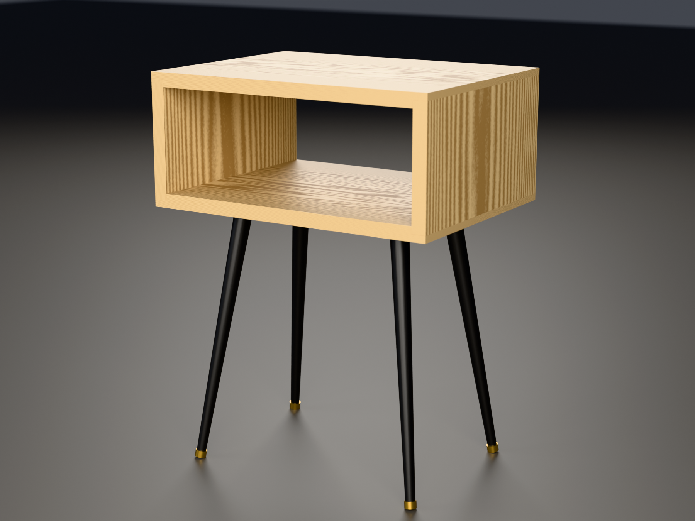

# Bedside table — Build Guide

A clean, compact mid-century cubby nightstand in solid yellow birch on 14" tapered steel legs.
**16" W × 12" D × 21" H overall**, sized to sit flush and level with an IKEA MALM bed
and nightstand setup.



---

## 0. Cut List & Stock Sourcing

### Finished Dimensions of the 4 Boards (Rabbet Joinery)

All boards are **3/4" (0.75") thick** solid yellow birch planed flat:

| Component | Quantity | Finished Size (L × W × T) | Joinery Details |
|---|---|---|---|
| **Top Board** | 1 | **16.00" × 12.00" × 0.75"** | 3/8" deep × 3/4" wide rabbet on inside face at both ends |
| **Bottom Board** | 1 | **16.00" × 12.00" × 0.75"** | 3/8" deep × 3/4" wide rabbet on inside face at both ends |
| **Side Panels (2)** | 2 | **6.25" × 12.00" × 0.75"** | Clean square 90° crosscuts; nest into the top & bottom rabbets |

- **Clear Internal Cubby Opening**: 14.50" W × 5.50" H × 12.00" D.
- **Overall Height on 14" Legs**: 21.00" nominal (level with MALM mattress line).

### Lumber Sourcing
Total board length needed: `16 + 16 + 6.25 + 6.25 = 44.5"` (~3.7 linear feet).
- **Lumber**: One 4-foot to 5-foot board of 4/4 Yellow Birch surfaced to 12" wide (or edge-glued from two 6-1/2" boards).
- **Surfacing**: S2S to 3/4" thickness with one straight-line ripped edge (SLR1E).

---

## 1. Hardware, Tools & Consumables

### Hardware
- **Legs**: 4 × **14" mid-century tapered steel legs** (KaizeooHaus or similar) with angled mounting plates and threaded floor leveler glides.
- **Screws**: 16 × **#8 × 5/8" pan-head wood screws** (short enough not to poke through the 3/4" bottom board).

### Shop Tools Used
- **Circular saw (or mitre saw) + straight edge**: For clean 90° crosscuts to size the 4 boards.
- **Mastercraft 2 HP Plunge Router**: For cutting the four 3/8" deep × 3/4" wide rabbets.
  - Bit: Standard 1/2" or 3/4" straight carbide router bit.
  - Guide: Clamped straight edge / level offset by router base radius.
- **Clamps**: 2 to 4 pipe clamps or 24" F-clamps for vertical clamping; 1 clamp across width for seating against rabbet shoulder.
- **Drill / Driver**: DeWALT 20V with 3/32" pilot drill bit and driver bit.
- **Measuring**: Tape measure, combination square, digital caliper, pencil.

### Consumables
- **Glue**: Titebond II (standard PVA wood glue).
- **Abrasives**: 120, 180, and 220 grit sandpaper + sanding block.
- **Finish**: Hardwax oil (Osmo Polyx-Oil 3043 satin) or Danish oil.

---

## 2. Step-by-Step Order of Work

### Step 1 — Crosscut the 4 Boards to Length
1. Square one end of the 12"-wide birch board with your circular saw against the clamped straight edge.
2. Cut the **Top** board to exactly **16.00"**.
3. Cut the **Bottom** board to exactly **16.00"** (clamp Top and Bottom together to verify identical length).
4. Cut the two **Side** panels to exactly **6.25"** (6-1/4").

---

### Step 2 — Route the 3/8" Rabbets on Top & Bottom Panels

```
      OUTSIDE FACE (16" Top Board)
+──────────────────────────────────────────+
│                                          │
└───┐                                  ┌───┘
 3/8"│ 3/4"                      3/4"  │3/8"
     +─────────────────────────────────+
                 INSIDE FACE
```

1. **Secure the workpiece**: Clamp the Top board flat to your workbench, inside face pointing up.
2. **Set the router guide**:
   - Chuck a 1/2" or 3/4" straight carbide bit in your plunge router.
   - Measure the exact distance from the edge of your router's sub-base to the cutting edge of the bit.
   - Clamp your straight-edge guide parallel to the end of the board so the bit routes exactly **3/4" wide** from the end.
3. **Make 2 shallow depth passes**:
   - *Pass 1*: Set plunge depth to **3/16"** (half depth). Make a steady, smooth pass across the 12" width.
   - *Pass 2*: Plunge to the final **3/8" (0.375")** depth. Make the final cleaning pass.
4. Repeat for the other end of the Top board, and both ends of the Bottom board (4 rabbets total).
5. **Dry fit**: Slip a 6-1/4" side panel into the rabbet recess. It should seat dead-flat against the shoulder with the outer faces perfectly flush.

---

### Step 3 — Edge Treatment: Eased Arrises vs Chamfers

> [!TIP] Why Eased Edges Beat Chamfers on Rabbet Casework
> On a 45° miter, a chamfer works because the joint seam is dead-center on the 45° corner.
> On a rabbet joint, however, the joint seam is located 3/8" down the side face. A 45° router
> chamfer on the corner cuts across the joint at an offset and visually clashes with the joinery.
> 
> **The Scandinavian / Japandi standard**:
> - Keep all outer planar corners square.
> - Hand-ease the arrises with a sanding block loaded with 220-grit paper (a subtle ~1/32" softening).
> - This feels silky and pleasant in hand while keeping the architectural lines clean and pure.
> - *(Optional)*: If you want to use your chamfer bit, run a light 1/8" chamfer ONLY around the
>   *inside* opening rim (where hands reach into the cubby).

---

### Step 4 — Pre-Finish the Interior (Shop Secret)
1. Sand the **inside faces** of all 4 boards to 180 and 220 grit.
2. Apply one coat of Osmo Polyx-Oil or finish to the inside faces only.
3. Keep the finish **1/4" away from the rabbet gluing faces** (mask with painter's tape).
4. Any glue squeeze-out during assembly will not adhere to the finished wood and pops right off with a damp cloth!

---

### Step 5 — Glue-Up & Clamping

Unlike miters, rabbet joints are **self-squaring**: the 3/8" internal shoulder mechanically traps the side panels square under clamp pressure.

1. Lay the Bottom board flat on the bench, rabbet pockets facing up.
2. Spread PVA glue (Titebond II) evenly along the rabbet shelves and shoulders.
3. Place the two 6-1/4" side panels upright into the bottom rabbets.
4. Apply glue to the top ends of the side panels and top rabbets, then place the Top board on.
5. **Apply clamping pressure**:
   - Place 2 to 3 bar/pipe clamps vertically across the carcass (pressing Top and Bottom into the sides).
   - Snug the clamps gently. Check for square with your combination square (the rabbets should automatically align it).
   - If needed, place 1 clamp horizontally across the width to snug the sides against the internal shoulders.
   - Tighten clamps firmly. Wipe off any squeezed-out glue.
6. Leave in clamps for **1 to 2 hours**.

---

### Step 6 — Final Sanding & Finishing
1. Once fully cured, unclamp the box.
2. Sand the exterior faces flush:
   - Start with 120 grit on a random orbital sander (or sanding block) to ensure the 3/8" top/bottom lips are flush with the sides.
   - Progress through 180 and 220 grit across all faces.
3. Hand-ease all edges with 220-grit paper on a cork/rubber sanding block.
4. Clean off all dust.
5. Apply 2 thin coats of Osmo Polyx-Oil 3043 (or Danish oil), buffing between coats with 0000 steel wool or a maroon Scotch-Brite pad.

---

### Step 7 — Leg Installation
1. Flip the finished box upside down onto a soft blanket.
2. Position the 4 mounting plates inset **1.75" from each outer edge**.
3. Align the angled legs so they lean outward symmetrically toward each of the 4 corners.
4. Mark the 16 screw holes.
5. Drill pilot holes using a 3/32" drill bit with tape wrapped at 1/2" depth (to prevent drilling through).
6. Drive the #8 × 5/8" screws securely.
7. Flip upright onto its brass leveler feet. Adjust the threaded brass glides to level the table perfectly beside the bed.
