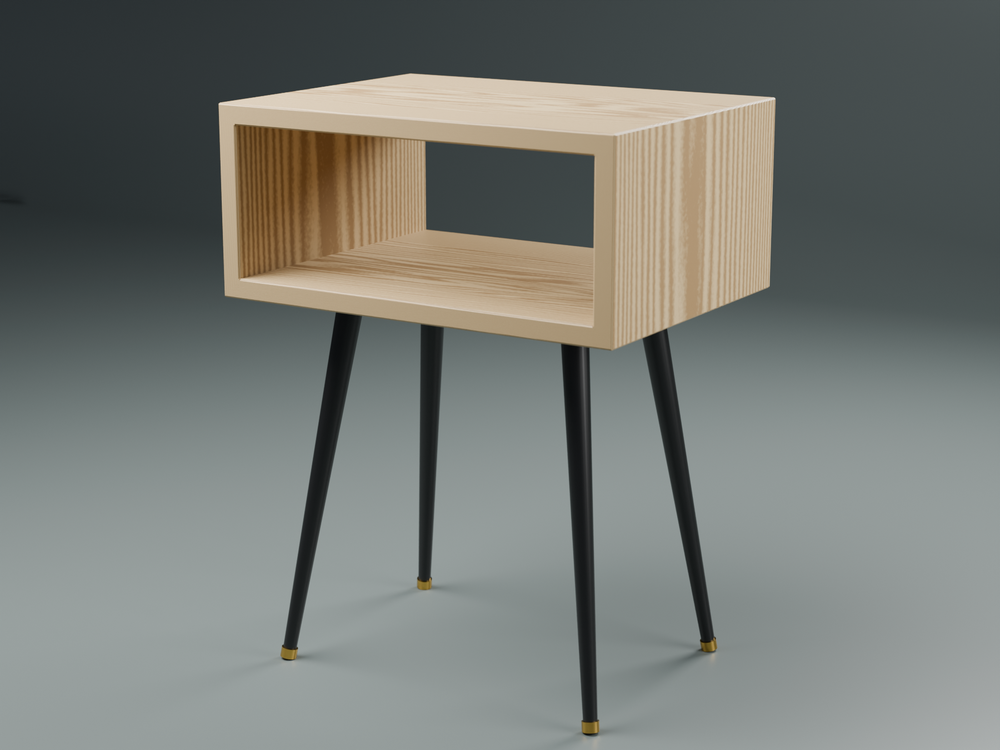
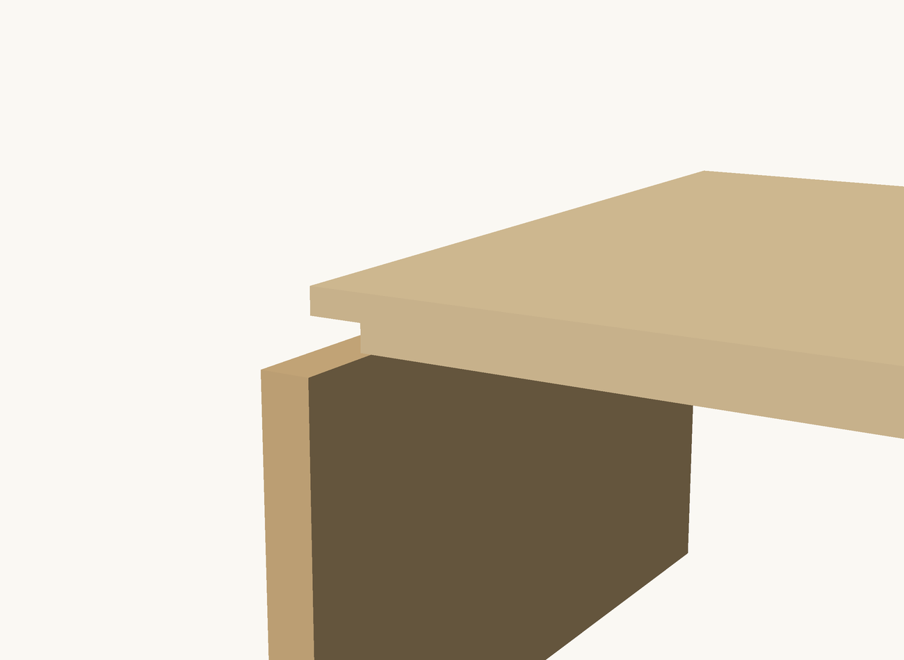
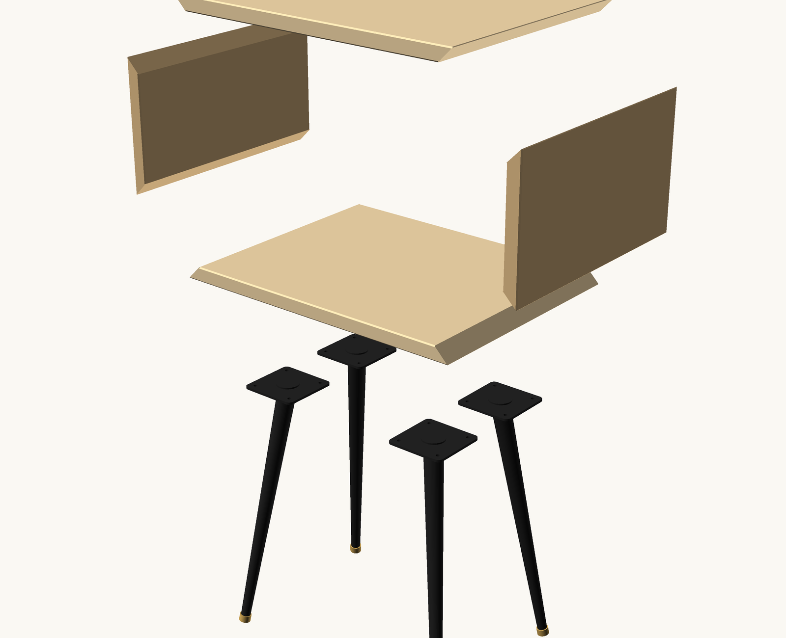
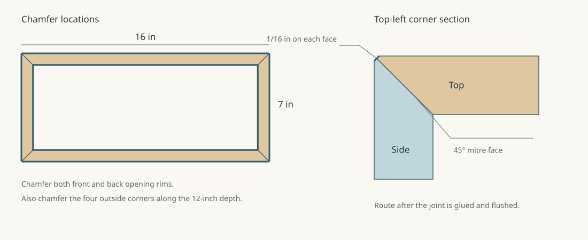

# Bedside table — build guide

A yellow-birch cubby with four mitred corners and small chamfers, on tapered steel legs. The finished table is **16 × 12 × 21 inches**; the wooden box is 7 inches tall. Quantities below are for one table.

## Stock and cut list

Start with flat, square-edged stock surfaced to **3/4 inch** and finished to **12 inches wide**. Edge-glue narrower boards first if needed. Keep the grain running along the lengths below, so it travels across the top and bottom and vertically on the sides. All four panels then move across the same front-to-back depth.

| Part | Quantity | Outside face, long point to long point | Inside face, short point to short point |
|---|---|---|---|
| Top | 1 | 16 × 12 × 3/4 in | 14-1/2 in long |
| Bottom | 1 | 16 × 12 × 3/4 in | 14-1/2 in long |
| Side | 2 | 7 × 12 × 3/4 in | 5-1/2 in long |

Both ends of every panel get opposing **45° bevels through the thickness**, across the full 12-inch width. These are not diagonal cuts across the face. Dimensions are measured before chamfering. If stock thickness differs, keep the outside lengths and recalculate the inside lengths as outside length minus twice the actual thickness.

The clear opening is **14-1/2 inches wide × 5-1/2 inches high**. The four finished outside lengths total 46 inches, but that is not the stock length: allow for opposing bevel cutoffs, kerfs and squaring. A **60-inch-long finished-width blank** allows rough blanks of 18, 18, 9 and 9 inches plus trimming. Double the quantities for a pair of tables.

## Tools and hardware

- Makita SP6000 track saw, guide rail, sharp finish blade and suitable rail clamps.
- Flat sacrificial cutting surface and same-thickness support scraps for the rail, including beyond the small side panels.
- Combination square, bevel gauge or reliable 45° reference, tape measure and caliper.
- Router with the 45° bearing-guided chamfer bit already in the shop; test its bearing and cutting diameter before use. A sharp hand plane and sanding block also work for this small edge treatment.
- Strong assembly tape, two light-duty straps or bar clamps with cauls, PVA wood glue, abrasives and chosen finish.
- Four 14-inch steel legs with mounting plates and floor glides. Buy the legs before drilling: the model's plate outlines and holes are placeholders for the actual hardware.
- Mounting screws sized to the actual plate and stock thickness. The intended #8 × 5/8-inch screws need enough clearance below the top face; check actual protrusion through a plate before drilling.

## 1. Prepare and label the panels

1. Flatten, surface and edge-glue the stock as needed. Finish every panel to the same thickness and 12-inch depth before cutting the joints.
2. Choose the outside faces and label the parts left, top, right and bottom. Mark the front edge and an assembly triangle on the inside faces.
3. Rough-cut oversized blanks, keeping adjacent pieces in sequence if their figure looks good together. Labelled sequencing helps the grain relate across corners; bevel waste means a perfectly continuous wrap is not guaranteed.
4. Keep scrap of the same thickness for a full test corner and chamfer setup.

## 2. Set up the track saw for bevel cuts

The SP6000 can make these cuts. The track runs across the panel at 90° to its long edge; **the blade tilts to 45°**. Its width capacity is governed by rail support, rather than a mitre saw's sliding crosscut capacity.

1. Disconnect the saw while setting the bevel and depth. Set and lock both bevel clamps. Use the guide-rail anti-tip slide lever as described in the [Makita SP6000 manual](https://cdn.makitatools.com/apps/cms/doc/prod/SP6/60a3fb77-ed0e-48e3-a43b-02d5a4e2ec44_SP6000J_IM.pdf).
2. Fully support the blank and offcut on a flat sacrificial surface. Support the rail at the same height before and after the 12-inch cut, and clamp both work and rail clear of the blade path. A 7-inch side panel needs support scraps alongside it so the rail cannot rock; do not balance the saw on that small panel alone.
3. Set enough cutting depth to sever the stock at the bevel while only entering the sacrificial surface slightly. Make a sample cut to confirm clearance with the rail fitted.
4. Make two sample bevels from the same stock and bring them together against a reliable square. Correct the setting until both faces close at 90°. Test the cut location at this bevel too; do not assume the scale or splinter strip alone gives a furniture-quality joint.
5. Keep the guide on the retained piece. Mark the waste and bevel direction for every end before cutting, so the outside face remains the longer face.

## 3. Cut the eight bevels and dry-fit

1. Cut the first bevel on each oversized blank. Protect its long-point edge while handling it.
2. Mark the finished outside length from that long point: 16 inches for top and bottom, 7 inches for each side. Reorient the work so the other bevel slopes toward the inside face, with the guide supported on the retained piece.
3. Cut the second bevel, leaving the blade kerf in the waste. Match top to bottom and side to side with a common stop or direct comparison; check depth and squareness as well as length.
4. Dry-assemble all four panels with tape. Check the front and back diagonals, both openings and every seam. A gap that closes only under heavy pressure needs a cut correction. A chamfer will not repair an inaccurate joint.

Mitres give a continuous outside corner but do not locate themselves like rabbets. Glue the full mating faces and get the fit right before assembly. Splines or loose tenons can add reinforcement, but they need another accurately located operation; this version uses plain glued mitres.

## 4. Sand the interior and glue the box

1. Sand the inside faces while accessible. If pre-finishing them, mask the entire bevels and keep finish away from the future chamfer cuts. Leave all gluing surfaces bare.
2. Lay the panels in left–top–right–bottom order, outside faces up, mating long points touching. Tape across the first three joints with several well-adhered strips. Turn the run over carefully so the bevel troughs face up.
3. Apply glue evenly to all eight bevel faces. Fold the four panels together and tape the final corner closed.
4. Add two straps around the rectangular cross-section, spaced along the depth, with padded corner cauls. Use only enough pressure to close the joints; ratchet straps can easily dent the wood or distort the box.
5. Compare both front diagonals and both back diagonals, check that the box sits without rocking, and recheck the seams. Remove accessible squeeze-out without washing glue into the grain. Leave clamped and allow the glue to cure according to its label before routing.

## 5. Cut the small chamfers after assembly

The model uses a **1/16-inch chamfer measured along each adjacent face**, at 45°. It runs around the outside and inside of both front/back opening rims, and along the four outside corners from front to back. The broad faces stay flat.

1. Remove dried glue, flush the joints with a sharp plane or sanding block, and sand the broad faces. Keep the edges square until the box is assembled; chamfering beforehand removes the tape-hinge tips and complicates alignment.
2. Set the chamfer bit on scrap to leave a 1/16-inch land on each adjacent face. Confirm that the bearing follows intact wood. Use a stable router base, secure the box and reposition it for each accessible edge rather than reaching around it.
3. Route the four long outside corners, then the outside front and back perimeters. With a handheld router above the work, conventional feed is counterclockwise around the outside perimeter. Make light passes and back up exit edges with scrap where possible.
4. Route the inside front and back opening rims with the bearing against the opening wall. Conventional feed is clockwise around the inside perimeter. Stop if the router base or bearing cannot stay supported; finish that section by hand with a block and a marked 1/16-inch line.
5. Inspect the three-way corner intersections and blend only the tiny remaining ridges by hand. Do not round over the chamfer flats or enlarge them while sanding.

## 6. Finish and fit the legs

1. Finish sanding to the grit specified by the finish manufacturer, remove dust and apply the finish. Keep coats thin around the chamfer intersections.
2. Once cured, put the box upside down on padding. The model places the **nearest edge of each mounting plate 1-3/4 inches from the side and front/back edges**. Use the actual plates as drilling templates and confirm the legs splay out toward the corners.
3. Check screw protrusion and set the pilot-drill stop so neither screw nor drill can emerge inside the cubby. Drill the pilots and attach the plates without overtightening.
4. Fit the legs and adjust the feet. Allow for the actual leg/plate/glide stack when matching the intended 21-inch height.
