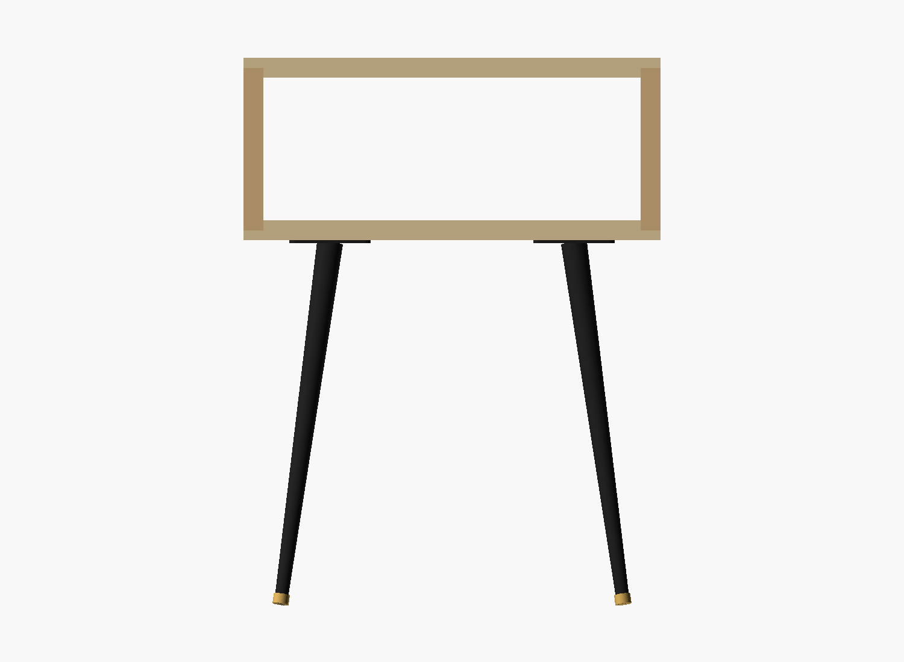
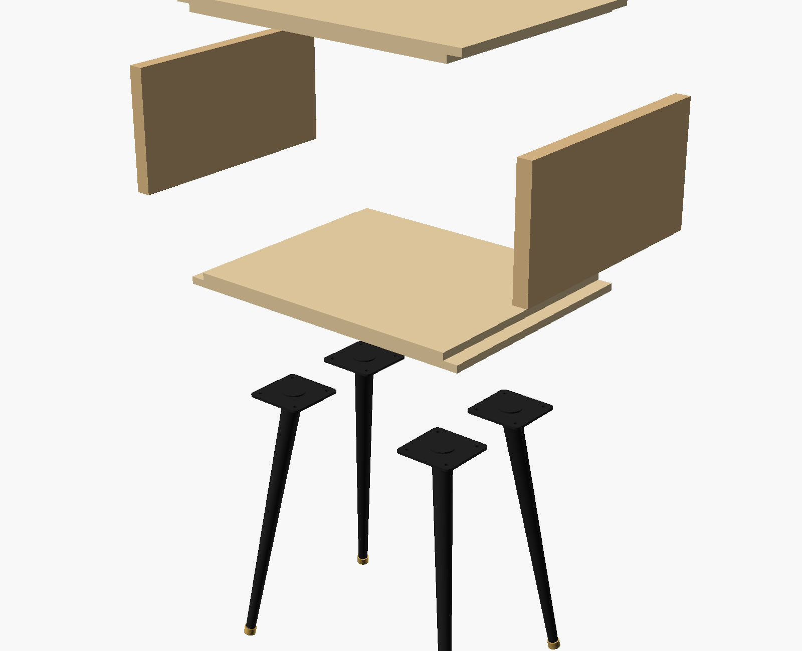
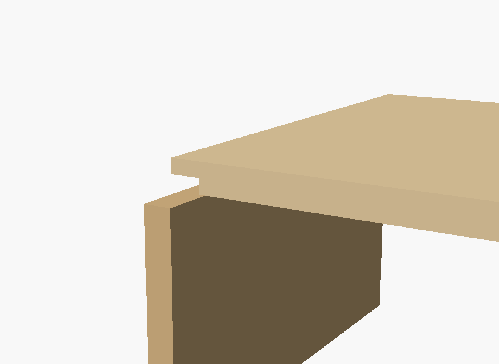

# Bedside table — solid yellow birch cubby on mid-century legs

**16" W × 12" D × 21" H overall** (a 7" tall carcass on 14" splayed metal legs).
A clean, compact cubby nightstand in solid yellow birch with self-squaring
3/8" rabbet joinery, eased architectural arrises, and a completely open
pass-through.


- **[BUILD.md](BUILD.md)** — Step-by-step DIY shop guide: router rabbeting setup, clamping, sanding, pre-finishing, and leg mounting.
- **[bedside_table.scad](bedside_table.scad)** — Parametric OpenSCAD model (all dimensions in inches; supports rabbet, miter, and butt).

## What it is

A modern bedside table designed around three deliberate decisions:

1. **Solid yellow birch instead of plywood.** The prototype in the inspiration
   photo is a plywood box with exposed plies on the face and raw butt joints.
   In solid yellow birch, the grain is fine and uniform, the wood is heavy and
   dense, and there are no exposed veneers or plies.
2. **Self-squaring 3/8" rabbet joinery.** Top and bottom boards cap the side
   panels in 3/8" deep × 3/4" wide routed rabbets. This creates a mechanical
   shoulder that squares the carcass under clamp pressure, provides rock-solid
   long-grain gluing area, and presents a seamless continuous face on top.
3. **Mid-century tapered metal legs.** Tapered conical steel legs—leaning 11°
   outward toward each corner with brass-accented leveler feet—give the piece real
   architectural stance and leave the floor below open and easy to clean.



## Proportions, Ergonomics & Bedroom Context

| Dimension | Measure | Rationale |
|---|---|---|
| **Overall height** | **21" – 21-5/8"** | **Matches an IKEA MALM nightstand (55 cm / 21-5/8")** on the other side of the bed. Level with the MALM mattress line; the adjustable threaded brass foot glides can dial in an exact millimeter-level height match. |
| **Carcass height** | **7"** | **5-1/2" clear opening.** Sits as a low, sleek console rather than a bulky crate. Eliminates empty vertical "dead air" while comfortably holding books, a tablet, watch, and charging station. |
| **Width** | **16"** | 14-1/2" clear internal opening. Compact bedside footprint, perfectly scaled for cozy spaces and modern bedrooms. |
| **Depth** | **12"** | **4:3 aspect ratio (16:12).** Natural, balanced rectangular footprint. Holds a bedside lamp and books with room to spare without crowding walkway clearance. |
| **Pass-through** | **Open** | Completely open front-to-back. No drilling grommets or fishing phone cords through holes—cords drop straight down the back into baseboard outlets. |

## Joinery and Edge Treatment



### Why Eased Edges Outshine Chamfers on a Rabbet Joint

On a 45° miter, a chamfer works because the seam is dead-center on the 45° corner.
On a **rabbet joint**, however, the joint is asymmetrical: the top board caps the
side, and the seam sits 3/8" down the side face. A 45° router chamfer cuts across
the seam at an awkward offset and visually fights the joinery.

Instead, the piece adopts the **crisp Scandinavian / Japandi approach**:
- Keep the planar corners square and honest.
- Gently **"break" the arrises by hand with 220-grit sandpaper** (~1/32" micro-softening)
  so edges feel silky to the touch without losing their crisp architectural geometry.
- *(Optional)*: A subtle 1/8" chamfer can be applied exclusively to the *inner* opening
  rim for tactile comfort when reaching into the cubby.



## The Waterfall Grain Sequence

```
+------------+------------------------+------------+------------------------+
|  Left (7") |        Top (18")       | Right (7") |       Bottom (18")     |
+------------+------------------------+------------+------------------------+
0"          7"                       25"          32"                      50"
```

Total blank length: **50" + 4 saw kerfs ≈ 51"**.

A single ~4-1/2 to 5-foot board of 4/4 yellow birch (planed to 3/4" and edge-glued to 13"
width) produces the entire box. When laid out and cut in order on the mitre saw,
the grain folds up into a continuous loop around the carcass.


## Cut List

| Part | Finished Dimensions | Qty | Notes |
|---|---|---|---|
| **Top** | 18" × 13" × 3/4" | 1 | 45° miter both ends, outside face 18", inside face 16-1/2" |
| **Bottom** | 18" × 13" × 3/4" | 1 | 45° miter both ends, outside face 18", inside face 16-1/2" |
| **Sides** | 7" × 13" × 3/4" | 2 | 45° miter both ends, outside face 7", inside face 5-1/2" |
| **Legs** | 14" tapered steel legs | 4 | Store-bought (e.g. KaizeooHaus 14" conical legs with mounting plates) |
| **Mounting** | #8 × 5/8" pan-head wood screws | 16 | For leg mounting plates into 3/4" yellow birch bottom |

## Assembly & Shop Notes

### Cutting the Mitres
1. Dimension the 13"-wide yellow birch panel flat and square.
2. Mark the grain sequence `L - T - R - B` across the face with a cabinetmaker's
   triangle so parts don't get swapped or flipped.
3. **Tool selection**: A 10" sliding mitre saw cannot crosscut a 13" panel at 45° (stroke maxes out around 8-1/2" at 45°). Cut either:
   - **At home**: With a circular saw (40T blade) riding a clamped straight-edge guide on sacrificial foam.
   - **At the shop**: On a cabinet table saw with a miter sled / sliding table saw (~$9 CAD / 8 mins).
4. Cut the mitres in sequential order, making 45° bevels so the outside faces
   match the outside dimensions (18" and 7").

### The Tape-Fold Glue-Up
Mitered boxes are notoriously tricky to clamp with bar clamps, but dead simple
with the blue tape method:
1. Lay the four boards outside-face up on the bench in sequence, tips touching.
2. Stretch 3–4 strips of heavy-duty packing tape or painter's tape tightly across
   every joint line.
3. Flip the entire 4-board assembly over so the inside faces and miter troughs
   point up.
4. Apply PVA glue (e.g. Titebond II) evenly to all 8 miter faces.
5. Roll the box together into a rectangle—the tape acts as perfect continuous
   hinges.
6. Pull the final corner tight with tape, wrap two ratchet straps around the
   perimeter with moderate tension, and check diagonal measurements for square.
7. Clean up internal glue squeeze-out immediately with a damp rag or straw.

### Leg Installation
1. Position the leg mounting plates inset **2" from the side edges** and
   **2" from the front/back edges** on the underside.
2. The legs angle outward toward the corners (compound 11° tilt).
3. Pre-drill pilot holes (3/32" bit with depth stop) to prevent splitting the
   hard yellow birch.
4. Drive 5/8" screws—short enough not to pierce the 3/4" bottom board.
5. Adjust threaded brass leveler glides to level the table and match the height of
   the MALM bedside table on the other side.
