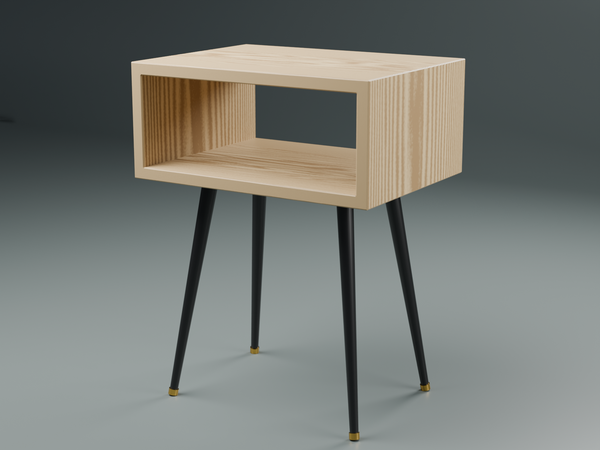
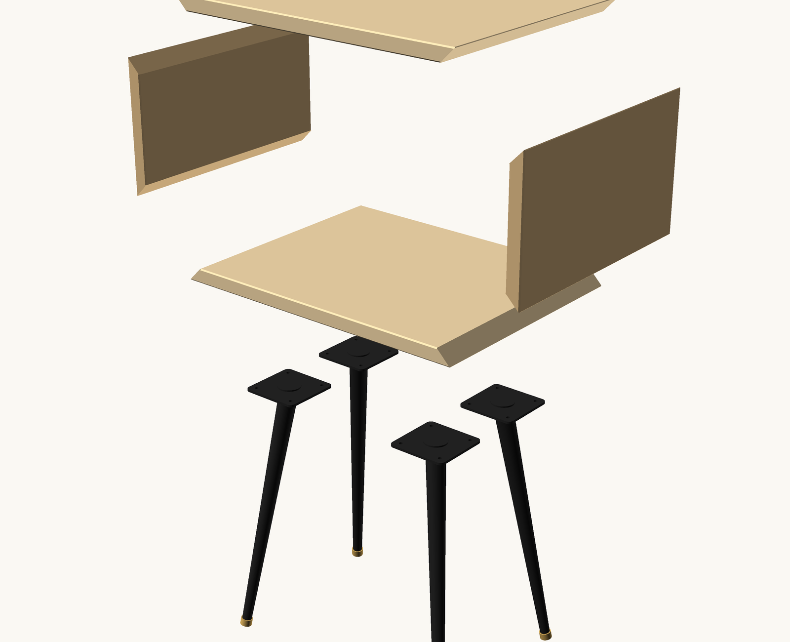
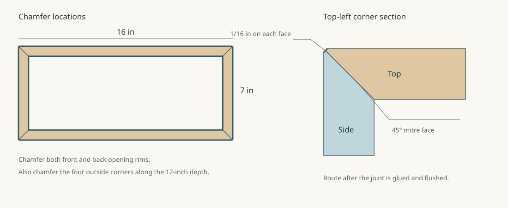

# Bedside table

An open yellow-birch cubby on tapered steel legs. **16 × 12 × 21 inches overall**: a 7-inch-tall wooden box on nominal 14-inch legs.



The four panels meet at 45° mitres. A 1/16-inch chamfer softens both opening rims and the four long outside corners. The front and back remain open for access and cables.

- [Build guide](BUILD.md): track-saw bevel setup, cut dimensions, tape-fold glue-up, chamfers and leg installation.
- [OpenSCAD model](bedside_table.scad): dimensions in inches; exports in millimetres. Mitres and chamfers are the defaults; rabbet and butt joints remain available as model options.
- [Published project](https://woodworking.dominiquepiche.com/projects/bedside-table/).

## Dimensions and stock

| Part | Quantity per table | Finished outside face, before chamfers |
|---|---|---|
| Top and bottom | 2 | 16 × 12 × 3/4 in |
| Sides | 2 | 7 × 12 × 3/4 in |
| Legs | 4 | 14 in nominal, with plates and adjustable feet |

Panel lengths are measured **long point to long point** across opposing bevels. The inside lengths are 14-1/2 inches for the top/bottom and 5-1/2 inches for the sides. The clear opening is 14-1/2 × 5-1/2 inches.

Allow about 60 inches of finished-width stock per table for the 46 inches of finished outside lengths, bevel cutoffs, kerfs and squaring. Keep the grain along the panel lengths so all four panels move across the front-to-back depth. Cut nearby parts in sequence for related figure, without assuming a perfect continuous grain wrap after the bevel waste is removed.



## Joinery and edges

The track saw makes the bevel cuts across the full 12-inch panel width. Calibrate on same-thickness scrap and dry-fit the whole box before gluing; mitres need accurate angles and matched opposite panels. Plain glued mitres are the current design. Reinforcing splines are an optional additional operation, not included in the model.

Chamfer after glue-up and flushing the seams. The 1/16-inch size is measured along each face, not across the diagonal flat. A bearing-guided router bit gives a consistent width; a sharp plane and marked sanding block can finish areas where the router cannot be supported.



## Generate the project files

```sh
projects/bedside-table/render.sh
projects/bedside-table/render_beauty.sh
python3 projects/bedside-table/verify.py
python3 lib/build_guides.py
```

The working views, mesh exports and per-panel Blender meshes derive from the OpenSCAD model. The visual guide drawing reads the same dimensions through the model's manifest mode.
