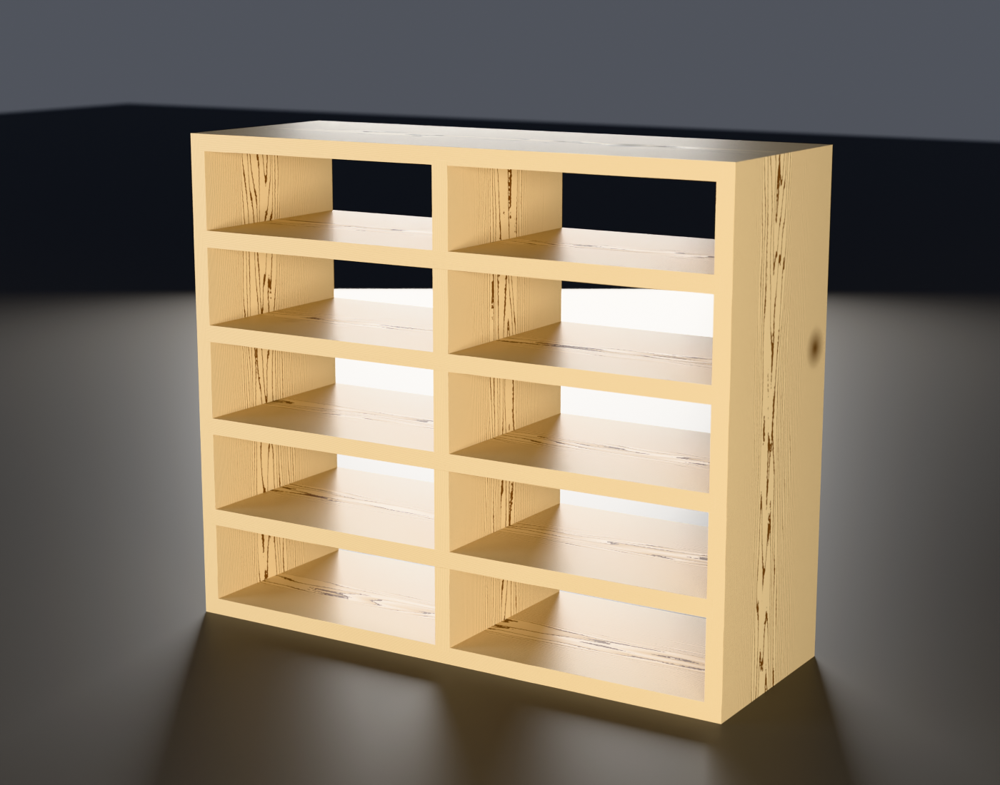

# Document unit

Ten cells for letter and A4 laid flat, in pine.
**26-1/4" W × 9-1/4" D × 22" H**, sitting on the floor. Two columns × five rows
of 12" × 3-1/2" openings.



**[Read the illustrated build guide](https://claude.ai/code/artifact/87fcd98c-7703-488a-8ec8-152ccdd2b3c9)** — every step with the jig
drawings, dimensioned part layouts and renders inline. Works on a phone in the
shop and prints cleanly. Also here as [`guide.html`](guide.html), generated by
`lib/guide.py` so its numbers can't drift from the model.

This is the piece to build **first**. It is the wine rack's joinery — housed
shelves, rabbeted corners, a half-lapped egg-crate grid — at a more forgiving
scale, in wood that costs a fifth as much, going in a closet where nobody
inspects it. Nothing about it is a simplification: every cut in the walnut rack
appears here at least once.

```sh
./render.sh          # views + STL/3MF
./render_beauty.sh   # Cycles, in pine
```

The model is [`lib/casework.scad`](../../lib/casework.scad) with
`PIECE="documents"`. `DEPTH` is 9.25 because 1x10 pine comes 9-1/4" actual and
there is no reason to give that away:

```sh
openscad -D 'PIECE="documents"' -D DEPTH=9.25 lib/casework.scad
```

## Cut list

Everything is 3/4" pine at the board's full 9-1/4" width. All parts are cut
along the board, so the 9-1/4 dimension runs front to back on every piece and
the whole case moves as one.

| Part | Length | Qty |
|---|---|---|
| Stile | 22 | 2 |
| Horizontal (2 end rails + 4 shelves — identical blanks) | 25-1/4 | 6 |
| Divider | 20-7/8 | 1 |

**About 18 linear feet, so three 8-foot boards** with enough left over to lose
one to a knot.

### Where the cuts go

**Stile** — six 1/4"-deep housings across the 9-1/4 width, measured to the
*lower* edge of each, from the bottom end:

```
0    4-1/4    8-1/2    12-3/4    17    21-1/4
```

The ones at 0 and 21-1/4 run off the end, so they are rabbets rather than
trenches. Same setup, same bit, no separate operation.

**Horizontals** — one 3/4"-wide lap slot, 4-5/8" deep, cut in from the **back**
edge, landing 12-1/4" to 13" from either end. Symmetrical, so it does not
matter which way round the board goes.

**Divider** — four matching slots, 4-5/8" deep, cut in from the **front** edge,
at 3-11/16, 7-15/16, 12-3/16 and 16-7/16 from the bottom end.

The two sets of slots open on **opposite** edges. That is what makes the grid
go together, and it also means the divider cannot drop in from above: the only
motion that engages the laps is a slide along the depth axis, divider entering
from the back and travelling 4-5/8" forward. Glue up in two stages.

## Views

| | |
|---|---|
| `hero.png` | three-quarter view |
| `front.png` | orthographic elevation |
| `exploded.png` | every part separated |
| `beauty_documents.png` | Cycles, in pine |
