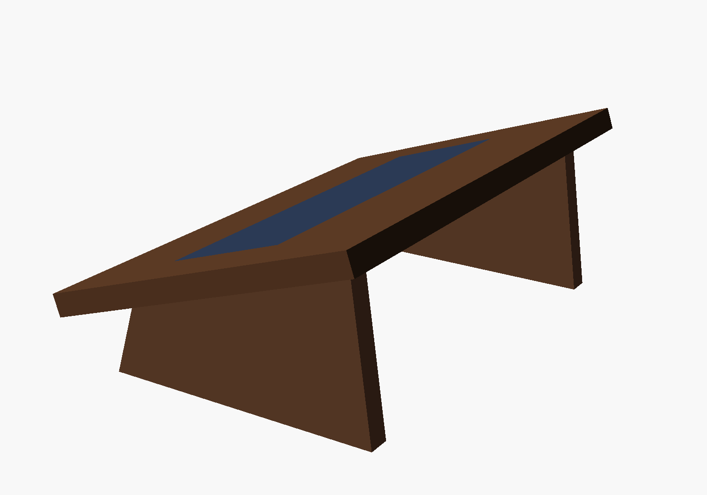
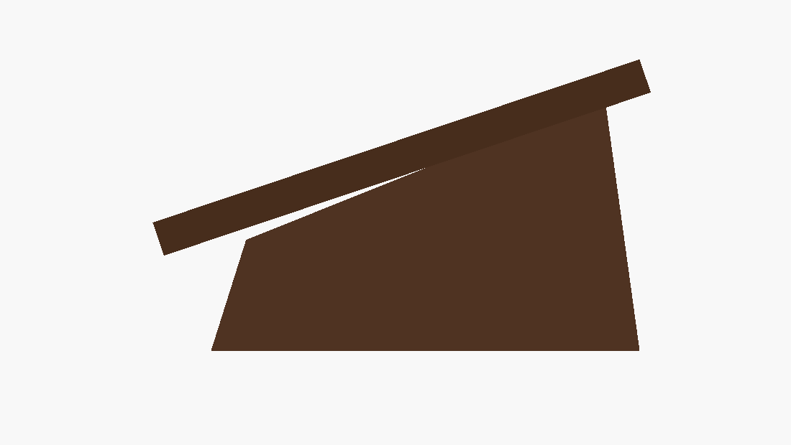
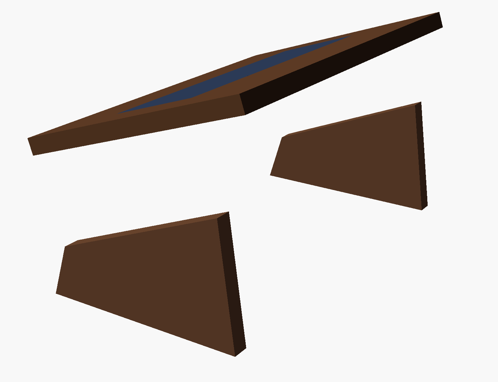

# Desk footrest — solid ramp on splayed sides

**17" W × 10-7/16" D**, rising from **2-3/4" at the near edge to 6-1/4" at the
far edge** — an 18.5° ramp. Solid top on two splayed sides, with a felt strip
inset where the feet land.



## What it's for

Not elevation — the chair and the desk both adjust, so height is already
solved. This is a **brace**. Sliding forward in a seat happens because the feet
have nothing to push against, so the legs extend to find purchase and that
shoves the hips toward the front edge. A ramp angled away from you turns a
forward foot push into a rearward reaction that seats you back:

```
   push into an 18.5° ramp  →  ~⅓ of the force returns horizontally, into the chair
```

About 20° is the ceiling before the ankle starts to complain, so this sits just
under it. Everything else in the design follows from that number.

## Why it looks like this

The first version was a slatted wedge in pine, and it read as a pallet. Three
things fixed it:

**Solid top instead of slats.** Gaps between square-edged boards say
"utilitarian" no matter how carefully they're spaced. A single plane says
furniture. It also lets the grain run uninterrupted across the whole surface,
which is most of what you're paying for when you buy walnut.

**The top overhangs the base, and the sides splay.** The sides are set in
1-1/4" from each end and 1-1/4" back from the front edge, and they stand 3/4"
wider at the floor than where they meet the top. That's the whole mid-century
move: a top floating over a base pulled inside its outline, on legs that lean
out. It costs nothing to cut and it's the difference between a wedge and a
designed object.

**A felt strip where the feet land.** Navy, to pick up the curtains and the
blues in the rug. It does three jobs at once — a smooth walnut ramp is
slippery in socks, felt is warmer underfoot than bare wood, and it puts a line
of colour into something that would otherwise be one flat brown plane. Recessed
3/32" so it sits flush rather than looking stuck on.



## Cut list

| Part | Size | Qty |
|---|---|---|
| Top | 17" × 11" × 3/4" | 1 |
| Side | 10-7/16" × 5-7/16" blank, cut to profile | 2 |
| Felt | 13" × 4" | 1 |

**The top is sized to come off one board.** 11" deep isn't arbitrary — it fits
inside a 1x12's actual 11-1/4", so there's no edge glue-up, which matters
because nothing in the shop clamps 17 inches. In walnut, ask for a board at
least 11" wide; about **2-1/2 board feet** covers the whole piece.

If the widest walnut you can find is under 11", say so — the depth comes down
and the ramp angle holds as long as `H_BACK` drops with it.

## Build

```sh
./render.sh          # views + STL/3MF
openscad projects/footrest/footrest.scad
```

1. **Crosscut the top** to 17" × 11". Crosscut the 11" dimension on the mitre
   saw and rip the 17" with the circular saw — the other way round exceeds the
   saw's 12" capacity.
2. **Rout the felt recess** — 13" × 4", 3/32" deep, starting 3-1/4" up the ramp
   from the front edge. Straightedge and the 1/2" straight bit: define the four
   edges first, then clear the middle freehand.
3. **Round over every edge of the top.** Generously — 1/4" or more. This is the
   detail that reads as quality from across the room, and it's what keeps a
   sharp arris out from under your socks.
4. **Cut the two sides.** Top and bottom edges parallel, ends leaning in 3/4".
   All four are straight cuts — mitre saw for the ends, circular saw and a
   straightedge for the long edges.
5. **Glue and screw the top down from below**, up through the sides' top edges.
   The screws go into long grain on the top's underside so they hold properly,
   and they're invisible from every angle you'll ever see this from.
6. **Felt** into the recess, with spray adhesive or contact cement.
7. **Non-slip pads** under both feet. A brace that slides across the floor
   solves nothing, and it's the one part that isn't wood and isn't optional.



## Views

| | |
|---|---|
| `hero.png` | three-quarter |
| `profile.png` | the wedge, from the side |
| `front.png` | as it looks from the chair |
| `top.png` | plan, showing the felt strip |
| `exploded.png` | every part separated |
| `sidepart.png` | one side alone |
