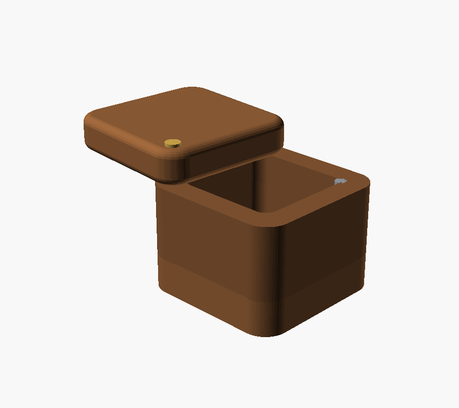
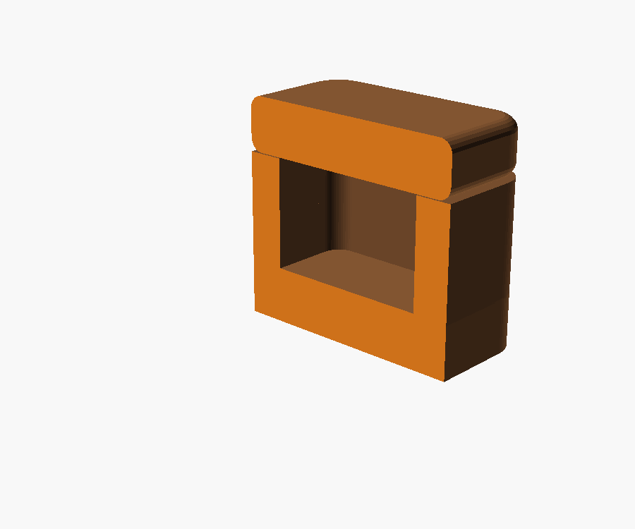
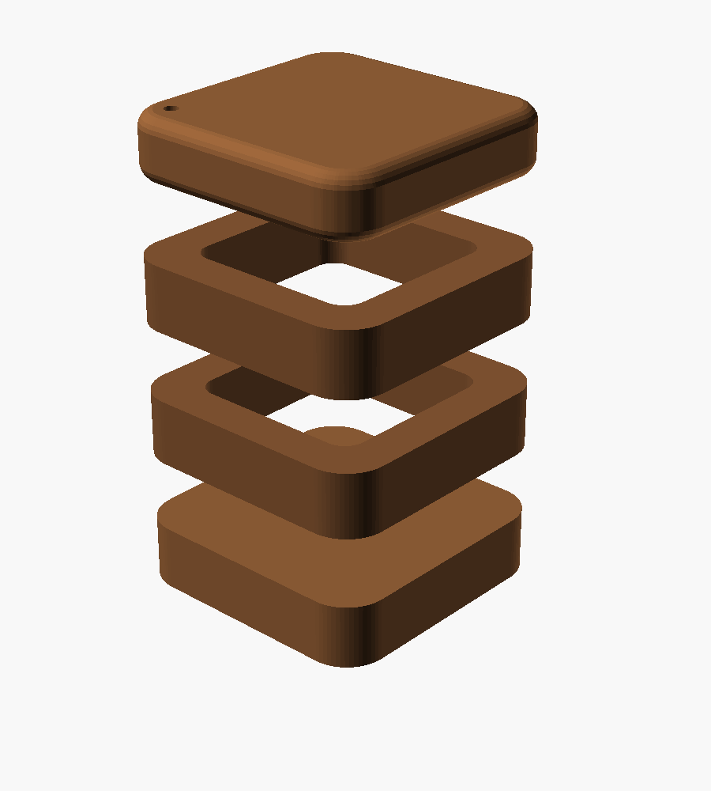

# Salt boxes — laminated hardwood, swivelling lid

A pair. **3-1/4" square**, differing only in height. Stack-laminated from
hardwood offcuts, with generously rounded corners and a lid that pivots on a
brass screw.

| | MSG | Sugar |
|---|---|---|
| Middle layers | 2 | 3 |
| Height | 3" | 3-3/4" |
| Cavity | 2-1/4" sq × 1-1/2" deep | 2-1/4" sq × 2-1/4" deep |
| Holds | ~123 ml (1/2 cup) | ~185 ml (3/4 cup) |

**The height difference is the label** — reaching for the wrong one mid-cook is
the failure mode a matched pair guarantees.

## The proportions

The first version had a 2-1/2" × 3/4" cavity, which is a tray, not a well. A
powder spread that thin is something you scrape at rather than pinch. **Same
volume, three times the depth** is the fix: narrower footprint, more layers.

## Corners

**Outside: 1/2" radius**, which is generous on purpose. A small ease on an
object this size just gives you a slightly less sharp box; at 1/2" the corners
become quarter-cylinders and the silhouette changes. This is also the edge your
hand meets several times a day, which is why it's rounded rather than
chamfered — a chamfer gives you two arrises where a roundover gives you none.

**Inside: 1/4" radius, and it's free.** A 1/2" cutter physically cannot leave
anything tighter, so a square template hands you rounded inside corners at no
cost. Nothing to decide.

They don't match, and they can't. Offsetting a rounded square inward *reduces*
the corner radius — a 1/2" outer radius with 1/2" walls would want square inner
corners, which no router cuts. The mismatch is geometry, not compromise, and
it's why the wall is thicker at the corners (about 0.6") than at the faces
(1/2"). That extra corner material is what the pivot screw lands in.

**The lid is rounded on every edge**, not just the vertical corners — it's what
the hand actually picks up.

## Why laminated and not hollowed from a blank

A solid block would keep the figure continuous, which matters on a small
object. But a blind pocket that deep can't be template-routed: the bearing has
to sit inside the template, and the deeper you plunge the higher it rides, so
past about 1" there's nothing guiding the cut. The alternative — a 2-1/4"
Forstner in a hand drill — wanders, and a cavity leaning 2° in a 3-1/4" box
shows up as visibly uneven walls.

Cutting the cavity **through** each middle layer sidesteps both. One template
pass per layer, dead square, no torque drama.

**Cut the layers in sequence from one board and stack them in the order they
came off.** The figure runs on through the glue lines and they nearly vanish —
you're unrolling the board and putting it back. That gets you most of the way
to what a solid blank would have given you.

## Making it

**Ten pieces for the pair, all 3-1/4" square and all 3/4" thick** — 2 bottoms,
2 lids, 5 middles. One thickness throughout means it all comes off the same
board and nothing needs planing to size.

1. **Cut all blanks to 3-1/4" square.**
2. **Rough the opening** in each middle layer — plunge the router in the middle
   of the waste and work freehand at ~1/4" per pass, staying 1/8" inside the
   line.
3. **One template pass at full depth.** The template is a frame: four strips of
   1/4" hardboard assembled into a 2-1/4" square window, taped to the blank with
   double-sided tape. The bearing runs the inside of the window. It happens
   once, at full depth, because a pattern bit guides nothing at shallower
   plunges — fine here, since it's only removing a sixteenth.
4. **Glue up** bottom + middles. Lid stays loose.
5. **Round the corners** — block plane to a chamfer, knock off the two new
   arrises, then sand. Ten minutes for eight corners, and the slight
   irregularity looks right on something handmade. A 1/2" roundover bit works
   too but is fiddly hand-held on a block this size.
6. **Pivot**: clearance hole through the lid, pilot into the corner post.
7. **Magnet and steel** at the corner opposite the pivot.
8. **Oil and wax.**

## Hardware, and why it matters here

**Brass or stainless for the pivot, never plain steel.** Salt rusts a steel
screw and bleeds a black stain into the surrounding wood that never comes out.

**Seal the magnet.** Neodymium magnets are nickel-plated and salt eats the
plating. Epoxy it into its recess so it's capped.

**Magnet to steel, not magnet to magnet** — same holding force, and no way to
get the polarity backwards.

**Mineral oil and beeswax, not polyurethane.** Food contact, and renewable when
it dulls — which it will, because you'll be in it daily.

## Wood

A salt box is the one project where good wood is affordable — a pair needs
about a foot of 4/4 — one thickness, one board. This is where offcuts of something
figured earn their keep. Maple takes a chamfer more crisply than almost
anything; cherry darkens with handling, which on a daily object is a feature.

## Views

| | |
|---|---|
| `L2_*.png` / `L3_*.png` | MSG and sugar |
| `*_hero.png` | closed |
| `*_open.png` | lid swung on the pivot |
| `*_exploded.png` | the layers |
| `*_section.png` | wall thickness and cavity depth |
