# Travel Yahtzee box

[Open the illustrated build guide](guide.html) · [Illustrated router-table guide](router-table-guide.html)

A Christmas gift: a slim sliding-lid box for a personalized 4 × 6-inch
scorepad, five 15 mm dice, and a Zebra TS-3-sized mini mechanical pencil.
The dice and pencil each have their own transverse compartment above the pad.

**Preferred: finger-jointed corners, grooved ¼-inch walls, ⅛-inch plywood lid.**
**Simple option: plain butt joints**, with the same outside dimensions and
contents and less corner machining. Glued-on lid tracks remain a selectable
alternative to grooves for either corner style.


| | Grooved walls | Added strips |
|---|---|---|
| Outside | 118.30 × 215.80 × 35.33 mm | 131.00 × 215.80 × 35.33 mm |
| Approximate inches | 4.66 × 8.50 × 1.39 | 5.16 × 8.50 × 1.39 |
| Wall / bottom | ¼-inch nominal Baltic birch | Same |
| Lid | ⅛-inch plywood | Same |
| Lid support | ⅛-inch-deep grooves in the long sides | ¼-inch projecting ledges and retaining strips |
| Paper pocket | 105.60 × 156.40 mm | Same, measured between track tips |

The grooves leave approximately ⅛ inch behind them and ¼ inch above them.
They are feasible in sound Baltic birch; check a sample for voids, veneer
breakout, lid fit, and damage after repeated sliding before machining the walls.
A wider supported blank or a carrier jig keeps the router stable. The rear
ends of the grooves stop before the corner joinery; do not rout through all
four corners. The front end is deliberately lower to let the lid enter.

The hardwood render changes the wall material only. A plywood lid remains
the default to limit seasonal changes across its width. Hardwood does not
justify reducing the remaining wall thickness or the upper lip. Thin finished
hardwood stock is an additional sourcing/thicknessing task; the shop has no
thickness planer listed.

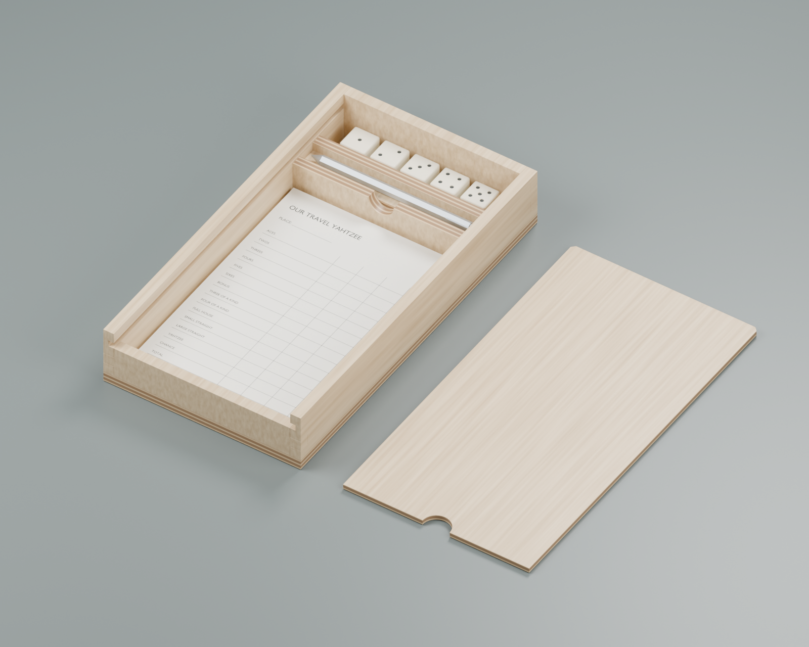

## Corners

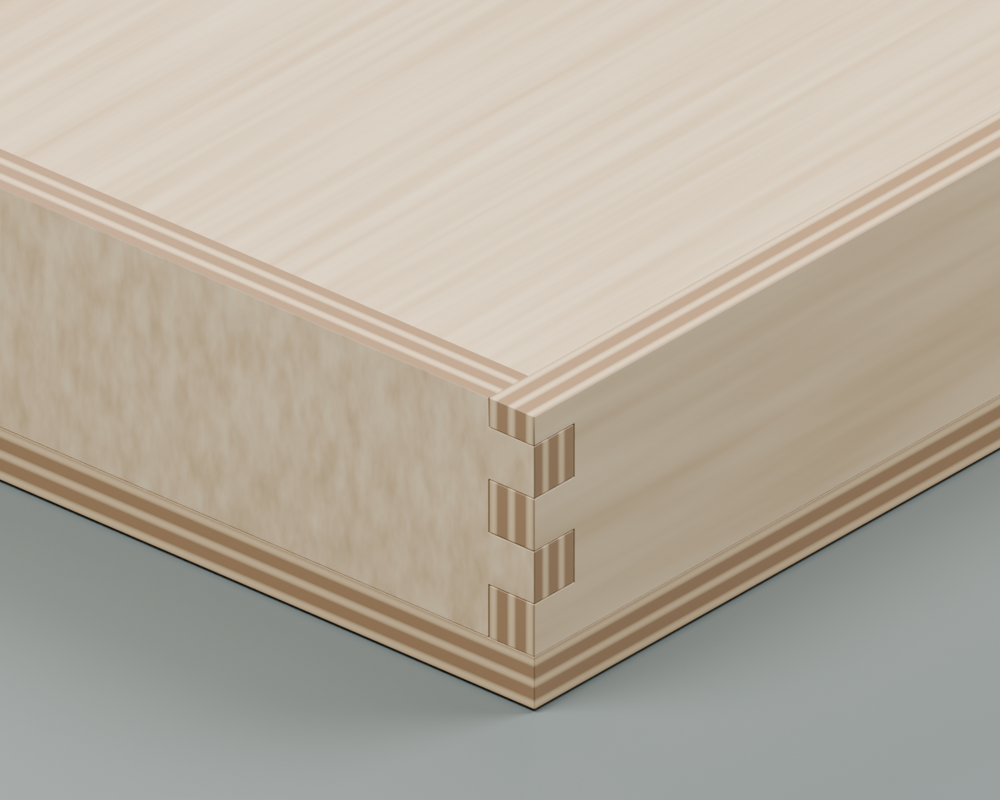

The finger pitch is ¼ inch. Side walls retain the lowest finger; end walls
have its complementary socket. Reference all machining from the bottom edge,
including the lower front: its height is three pitches, while the back has
a final partial finger of about 3.6 mm. Do not center the pattern separately
on each board. Joint depth follows actual stock thickness, not finger width.

### Simple option: plain butt joints

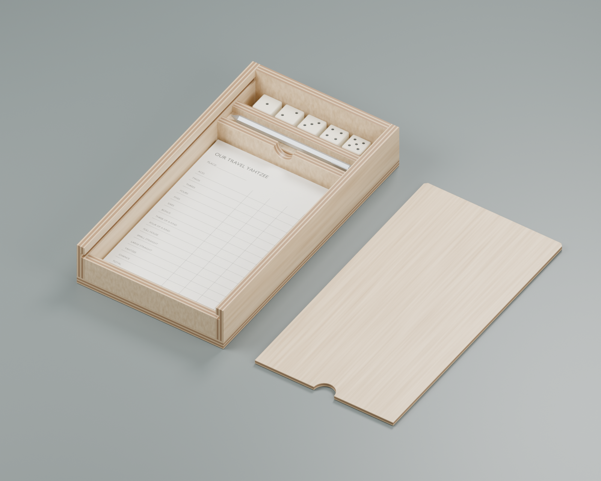

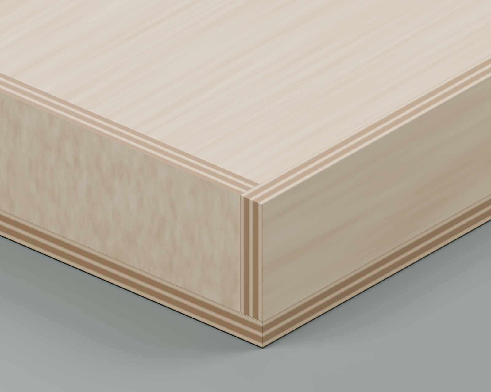

The long sides run full length; the ends fit between them. This exposes one
full wall thickness of plywood edge at each end of the front and back.
No corner recesses or indexing jig are required. The groove, lid, compartments,
and overall dimensions match the finger-joint version, but the end blanks are shorter:
use `exports/butt_cutlist.md`. The applied bottom helps hold the assembly square;
plain corners have less glue area and no locating shoulder, so use a square
assembly fixture and test a representative glued scrap corner before choosing
this construction for travel. No pins or hidden reinforcement are shown.

## Build sequence

The illustrations use the simple butt-joint walls. The finger-joint version
follows the same assembly order after its corners are machined. Exploded views
show where parts belong; they do not show clamps or an operating router setup.

### 1. Measure and prepare the parts

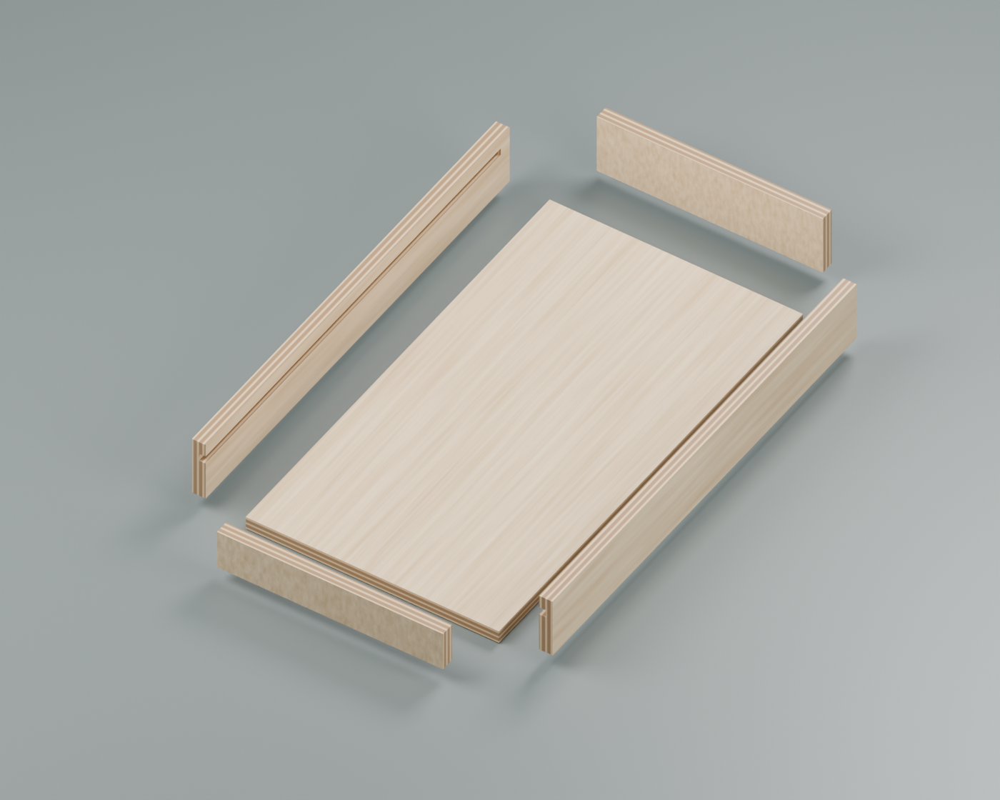

Measure the actual wall, bottom, and lid stock; measure the dice and pencil
including clip. Print a full-size score sheet and test the writing space.
Update the model and regenerate the cut list. The pictured scorecard is
a layout placeholder, not the personalized printable score sheet.
Make a scrap corner and a separate grooved-wall/lid sample first. If using
finger joints, follow [the optional table and jig guide](ROUTER_TABLE_GUIDE.md).
Cut lid/bottom panels and long wall strips from a larger supported blank
with the track saw. Workholding must keep both the rail and the retained
stock stable throughout each cut. Crosscut narrow strips using a fine
handsaw and shooting board; do not rely on the mitre saw whose guard is
still flagged for service in the shop inventory.
### 2. Cut the corners and lid grooves

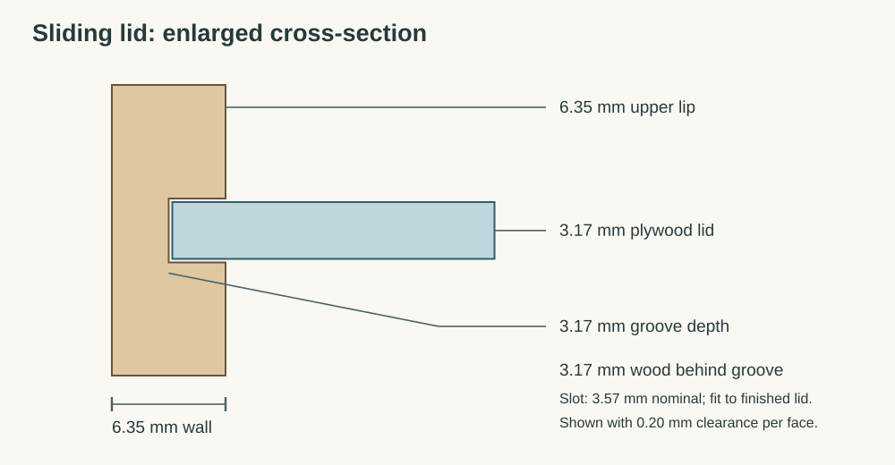

Machine corner joints before the delicate grooves, retaining bottom/inside
reference marks. Dry-assemble all four walls and check both diagonals.
Cut lid grooves in a supported fixture, stopping before the rear joinery.
For a handheld router, use a clamped carrier with equal-thickness packing
supporting the base, positive guide and travel stops; keep the small wall
mechanically secured. The groove is shallow; take controlled passes using
the bit maker's limits. Fit the slot to a finished lid sample, not its
nominal label. A ⅛-inch cutter needs an offset second pass if extra slot
width is required. The ¼-inch finger-joint bit is too wide for this slot.
In strip mode, omit the grooves. Glue the lower ledges and upper retaining
strips against a removable lid-thickness spacer plus clearance shims.
Protect the spacer against glue. Notch the divider shoulders to clear the
lower ledges, as shown in the model.
### 3. Dry-fit and glue the wall frame square

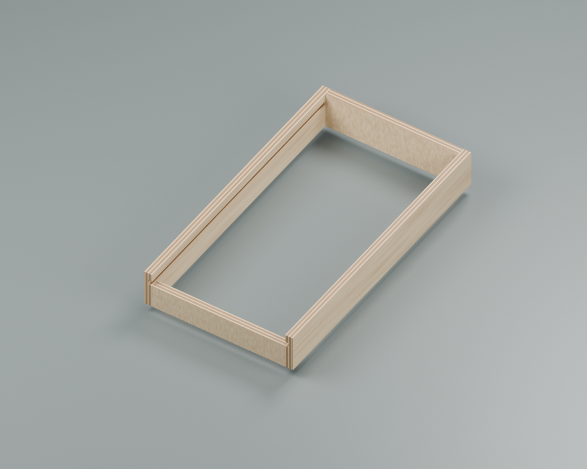

The short front is at the lid-entry end. Keep the two grooves facing inward
and aligned. Dry-fit on a flat surface and compare both diagonals. Use square
assembly blocks and appropriate clamping for glue-up; these are omitted from
the illustration. Keep glue out of the tracks.

### 4. Attach the applied bottom

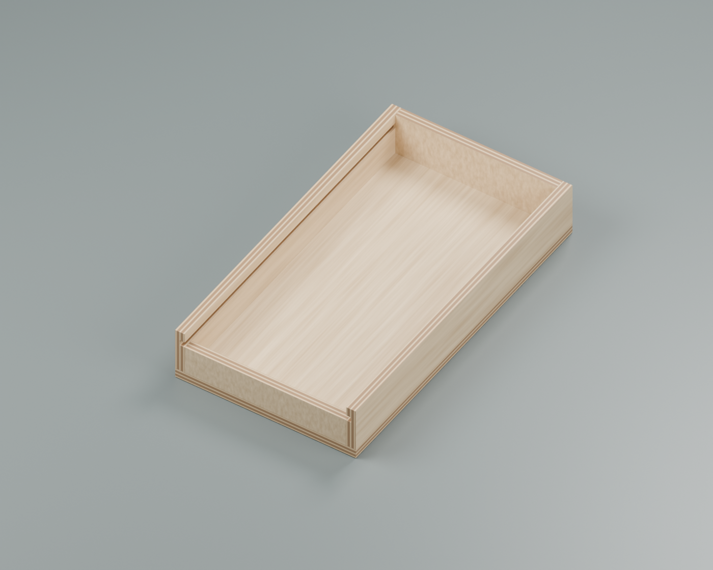

Glue the bottom to all four walls with even contact around the perimeter.
The applied plywood bottom is intentional: a second groove near the bottom
would remove more wood from these thin walls. Let the assembly stabilize
before fitting the internal pieces.

### 5. Add the dividers and raised pencil floor

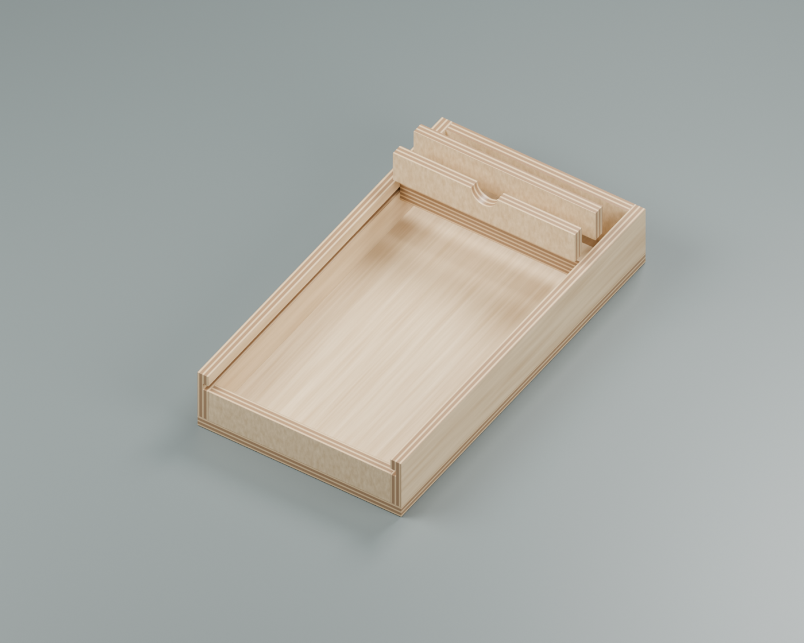

Cut the dividers and the semicircular paper finger scoop. Laminate the two
¼-inch pencil-riser pieces in the pencil compartment: the tiny pencil needs
to sit high enough to grasp through the scoop, rather than disappear below
the divider. The divider nearest the paper has the scoop; the dice divider
stays full height. The two narrow riser layers sit between the dividers.
Ease the lid's back corners to clear the round-ended stopped grooves.

### 6. Fit the sliding lid, then finish

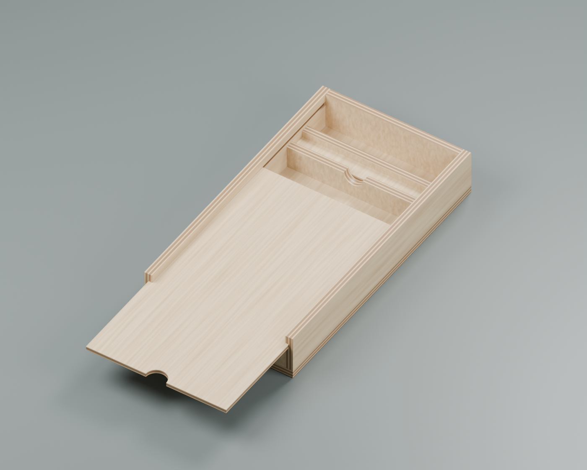

Fit the lid gradually, soften exposed edges lightly, and finish. Do not
round away finger-joint faces or the thin groove backing. Keep heavy finish
buildup out of the tracks; use a finished scrap to establish running fit.
Choose and test a positive travel closure before using it in luggage.
The current model has a finger notch and a rear stop, but no latch or
magnet pockets. Friction alone is not a validated travel catch.

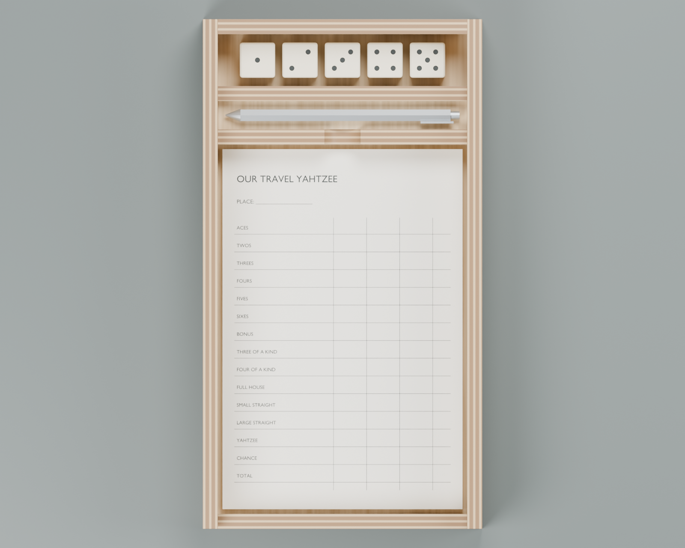

## Timing decision

Budget estimates below are planning allowances, not measured build times.
Both routes share paper design, stock sourcing, a lid-fit sample, assembly,
and the chosen finish's actual drying/curing schedule.

| Route | Additional allowance | Decision checkpoint |
|---|---|---|
| Butt joints + grooves | One groove setup/practice session; no corner jig | Scrap corner glues square and groove slides cleanly |
| Finger joints + grooves | A weekend for table construction and another session for jig tuning, potentially longer | Complete four-sided scrap box assembles square without forcing |

With Christmas on December 25, a useful personal cutoff is **December 1**:
if the table and practice box are not working then, use butt-jointed walls and
keep the remaining time for lid fitting, personalization, and finish. This is
an optional scheduling suggestion; no reminder or deadline has been created.

## Model and renders

Open `yahtzee_box.scad` in OpenSCAD. The controls are `joinery`, `track`,
`mode`, and `SHOW_CONTENTS`; dimensions are near the top. Source dimensions
are inches and output meshes are millimetres, matching the rest of this repo.

```sh
python3 projects/travel-yahtzee/build.py
python3 projects/travel-yahtzee/build.py --render
python3 projects/travel-yahtzee/build.py --only butt --render
python3 projects/travel-yahtzee/verify.py
blender -b -P projects/travel-yahtzee/render_guides.py -- --samples 48
python3 projects/travel-yahtzee/illustrate_guides.py
python3 projects/travel-yahtzee/build_guides.py
```

The build exports individual OpenSCAD meshes, blank-size cut lists, and a
manifest. Blender imports those meshes rather than reconstructing the box.
The saved `yahtzee_box.blend` opens on the preferred open-box scene. Render-only
paper printing and material grain are illustrative, with no invented inside jokes.

`exports/finger_cutlist.md`, `exports/butt_cutlist.md`, and
`exports/finger_strips_cutlist.md` are generated; change the model and regenerate
rather than editing them. They give blank sizes before machining and do not
include saw kerf or cutting allowances.

## References

- [Mastercraft 054-6821-2 manual](https://apps.mecanair.net/mecanair/st/gesfic4b.asp?cuser=&id1=&kscannerdoc=554806)
- [Small-part routing and support fixtures](https://www.woodcraft.com/blogs/shop-knowledge-guides/routing-small-parts)
- [Fine Woodworking: thin-part sliding-lid box](https://www.finewoodworking.com/project-guides/boxes/sleek-box-with-a-sliding-lid)
- [Zebra TS-3 dimensions](https://www.bundoki.com/?pid=59534519): reference envelope, not a claim of exact product geometry.
