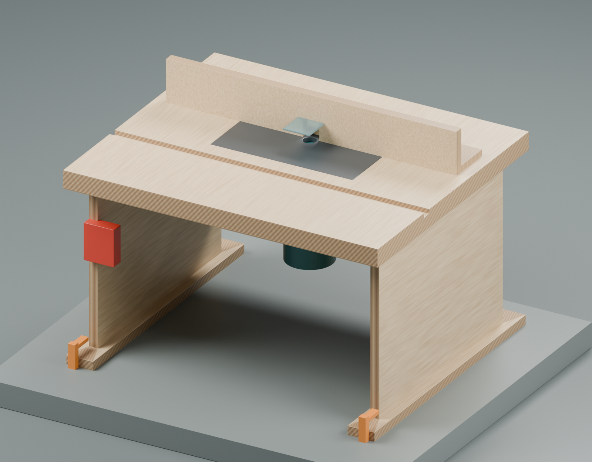
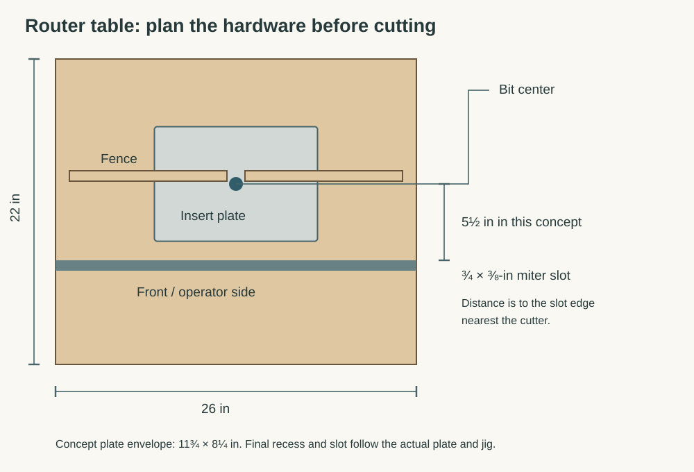
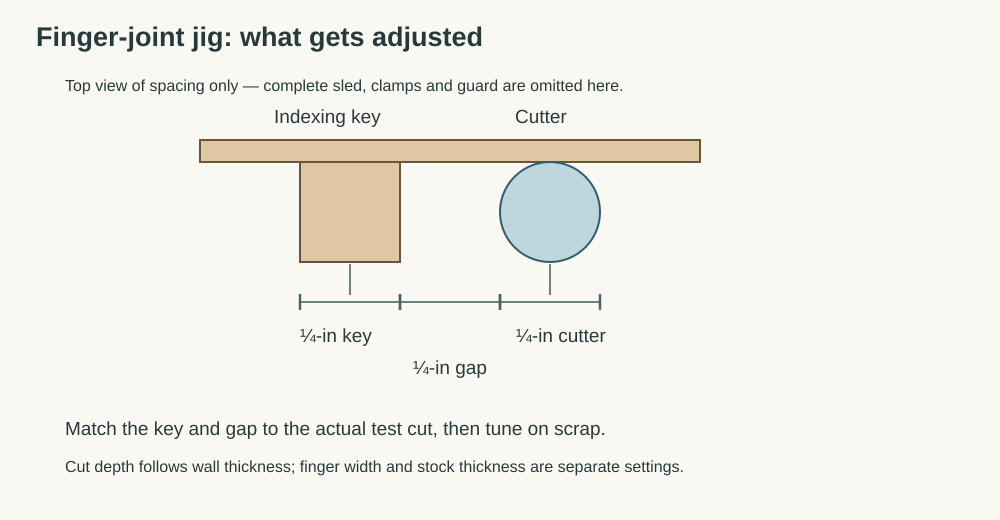
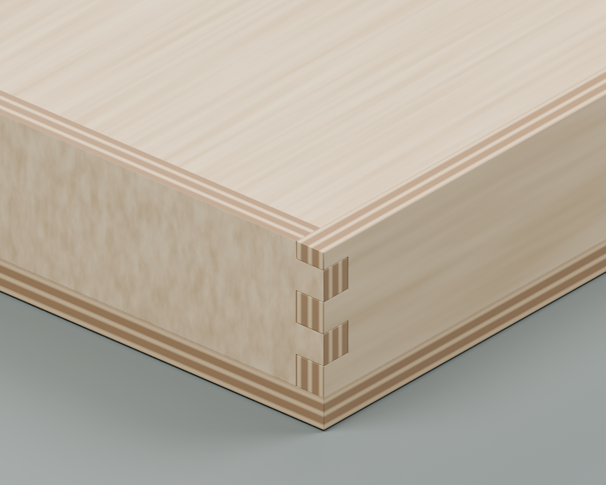
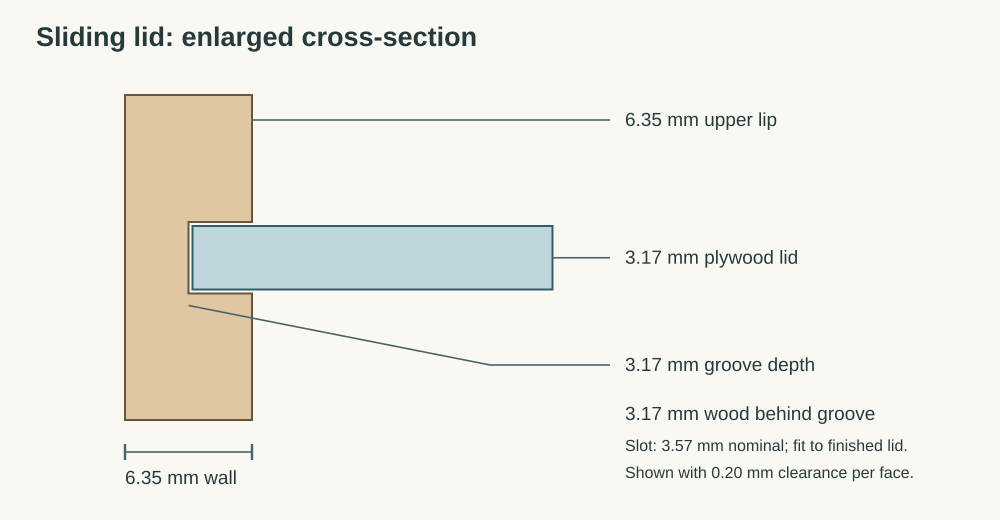

# Optional router table and finger-joint setup

[Open the illustrated version](router-table-guide.html) · [Box build guide](guide.html)

For the travel Yahtzee box, the preferred corners have ¼-inch fingers in
¼-inch walls. A small benchtop table makes this repeatable and can serve future
boxes. Plain butt joints are the simple option if setup time becomes the project.

This is a construction and commissioning guide for a shop-built table around
**purchased mounting hardware and a documented jig**. Router mounting holes,
plate recess, screw lengths, guard clearances, and table-slot location must be
set from the actual hardware. The box model is not a drilling template for
the table.

The model shows the arrangement of the main parts. The router is a generic
size envelope, not a detailed replica of the Mastercraft. Mounting fasteners,
fence locks, electrical leads and dust fittings follow the selected hardware;
the render is not a complete operating setup. Editable concept:
`router_table.scad` and `router_table_concept.blend`.

## What is already available

The router is confirmed as **Mastercraft 054-6821-2**, with both bases and
the ¼-inch collet adapter sleeve. Use the fixed base for table mounting.
The manual specifies 25,000 RPM; choose cutters rated for that speed and
install them using its collet-engagement instructions. The track saw, router,
drill, clamps, square, and calipers cover the main table-building operations.
See the [manufacturer manual](https://apps.mecanair.net/mecanair/st/gesfic4b.asp?cuser=&id1=&kscannerdoc=554806).

## Buy versus build

| Build | Buy / select first |
|---|---|
| Flat supported tabletop and rigid bench-clamped base | Router-rated phenolic or aluminum insert plate, blank if necessary |
| Straight adjustable fence with replaceable faces | Plate leveling **and retaining** hardware; reducer ring suitable for small cutters |
| Fence dust box and hose support | Enclosed plug-in paddle switch, rated for the router's motor load and local supply |
| Auxiliary sacrificial backers and larger clamping carriers | ¼-inch **cutting diameter** straight or spiral bit for fingers |
| Optional finger-joint jig, if following a complete published plan | Small groove cutter, typically ⅛-inch cutting diameter, chosen for the actual lid |
| | Documented finger-joint jig with stock clamping and cutter shielding; compatible miter track if required |

The confirmed adapter accepts ¼-inch-shank bits. Cutting diameter is a separate
measurement. Neither an expensive lift nor a new router is necessary for the
first version. A blank commercial plate avoids guessing another router's
hole pattern; [Rockler explains the plate options](https://www.rockler.com/learn/router-plate-buying-guide).

## Table construction

**Suggested envelope: about 26 × 22 inches**, with a laminated top around
1½ inches thick and an open, braced base tall enough to clear the inverted
router and allow comfortable access. These are starting dimensions, not a
hardware-specific cut list. Check the actual router, mounting plate, and jig
on a full-size layout before cutting the top.

1. **Select the plate and jig first.** Put the plate, fence, slot, guard, and
   router controls on a full-size drawing. Preserve space for clamps, the dust
   hose, screw heads, and the jig's whole travel. The jig must not run over
   leveling screws or unsupported edges.
2. **Laminate and brace the top flat.** Two nominal ¾-inch sheets are a
   practical starting point. Use a smooth wear surface, seal exposed MDF edges,
   and add support beneath the plate opening without blocking the motor.
   The opening weakens the top, so check it again with the router installed.
3. **Recess the plate using its actual template.** Provide a continuous
   supporting ledge or the plate maker's specified support system, leveling
   points, and positive retention against lifting. Fit the plate flush across
   the whole perimeter; it must neither rock nor catch a sliding workpiece.
4. **Mount the fixed base through its intended mounting points.** Use the
   correct machine-screw thread and engagement, with flush heads. Verify screw
   length against the base rather than copying another router's dimensions.
   Confirm the motor clamp, collet, and height adjustment remain accessible.
5. **Build a rigid, braced stand with bench-clamping surfaces.** Clamp it to
   a solid bench for use. Leave ventilation and chip clearance around the
   router; do not enclose its cooling openings in a tight box.
6. **Add the switch without homemade mains wiring.** Use a purpose-built,
   motor-rated plug-in unit mounted where it can be reached immediately.
   Test that it controls this router and that you can stop it without reaching
   beneath the top. Unplug the router before adjustments and cutter changes.
7. **Fit fence, guard, and extraction.** The general fence should lock firmly
   at both ends, with coplanar replaceable faces and a small cutter opening.
   Use a transparent adjustable guard and dust pickup. The finger-joint sled
   has its own workholding and guarding requirements; the general fence does
   not replace them. [WOOD's table overview](https://www.woodmagazine.com/video/getting-the-most-from-your-router-table)
   shows these features together.

## Finger-joint jig choice

For the shortest learning path, pair the handmade table with a documented
commercial sled. The Rockler jig is one example, not a requirement or a verified
local purchase recommendation. Its instructions call for a **¾ × ⅜-inch
miter slot**, with the edge nearest the cutter **4½–6¼ inches from the bit
center**. Fit the real jig before machining that slot; do not assume any table
slot will work. Check current availability before building around it.
[Jig instructions, June 2025](https://go.rockler.com/tech/59032-rockler-box-joint-jig-inst.pdf)

A handmade indexing sled is also possible, but use a complete published design
with a guided travel path, secure work clamping, sacrificial exit support,
cutter shielding, and stops that prevent cutting into handles or hardware.
An upright fence and a loose indexing peg are not a complete small-part jig.

The indexing geometry is simple: the key width matches the **actual cut width**,
and the clear gap between key and cutter also matches that width. Thus nominal
¼-inch fingers have a nominal ½-inch center-to-center spacing. Runout, cutter
size, key fit, and fence alignment all affect the result. The test joint decides
the fit; a ruler setting alone does not. [Rockler's joinery overview](https://www.rockler.com/learn/cutting-box-joints)
explains the indexing principle and accumulated spacing error.

## Commission the table before machining the gift

- With power disconnected, check router mounting, motor lock, plate retention,
  level, cutter engagement, guard position, and jig travel. No clamp, screw,
  or backer fastener may enter the cutter's swept area.
- Clamp the table to the bench. Connect extraction, wear eye/hearing protection,
  and use dust protection appropriate to the work. Check the accessible stop
  switch before cutting.
- Make an ordinary controlled test cut with the appropriate fence/guard first.
  Stop if the table shifts, the plate moves, or the router height creeps.
- For small walls, use the jig's clamps and handles. Follow its feed path and
  stroke limits; do not improvise hand-held short parts beside an exposed bit.
  The current Rockler instructions specify **one workpiece at a time**.

## Tune a finger joint on the actual stock

1. Prepare several scraps with the same thickness and wall height as the
   chosen material. Mark bottom edge, inside face, and mating corners.
2. Fit a fresh sacrificial backer. Set cutter projection above the jig's
   work-support surface to actual wall thickness plus a tiny finishing
   allowance. Jig-platform thickness counts: do not measure from the table
   surface if the work sits higher on a sled.
3. Match the key and spacing to the cutter's measured test slot. Cut one
   marked scrap using the jig manufacturer's sequence, then the complementary
   scrap with the specified one-finger offset. Keep every bottom reference
   consistent.
4. Test by hand. The joint should seat with light hand pressure and stay square.
   A joint needing hammering can split the thin fingers; a sloppy joint needs
   recalibration. Change one setting at a time and repeat on fresh scraps.
5. Make a complete four-sided practice box. Check diagonals, both ends of each
   board, and front/back pattern orientation. Label the successful setup and
   retain its reference samples until the gift is assembled.

These procedural details are adapted from the jig's instructions; use the
instructions supplied with the actual jig for its complete operating sequence.

## Apply it to the Yahtzee box

Cut the fingers **before** the lid grooves, so an unsupported groove lip is
not presented to the finger cutter. Use the same bottom reference on the lower
front and full-height back. The front is three finger widths high; the back
has a partial top finger. A generic instruction to center every pattern would
misalign them.

For grooved walls, use the separate narrow cutter and a supported, clamped
carrier with positive guide and travel stops. The target is about ⅛ inch deep,
with slot width fitted to the actual finished ⅛-inch plywood lid. Stop before
the back corner joints; remove the lid's rear corner tips to clear the rounded
groove ends. Test a scrap first and leave the remaining wall and upper lip
intact. Clearances in the CAD model are starting values, not a promise that
nominal plywood, finish, and humidity will produce that exact fit.

## Timing checkpoint

Allow a weekend for constructing and checking the table and a separate session
for finger-joint practice; a first setup can take longer. Buy/select the plate,
switch, and jig before allocating that weekend. Shipping and finish curing
must fit the remaining calendar too.

**Suggested decision date: December 1, 2026.** If a full scrap box and a working
groove/lid sample are not successful by then, switch to the butt-joint version.
Keep the table as a useful shop project without making the gift depend on
last-minute jig calibration.
